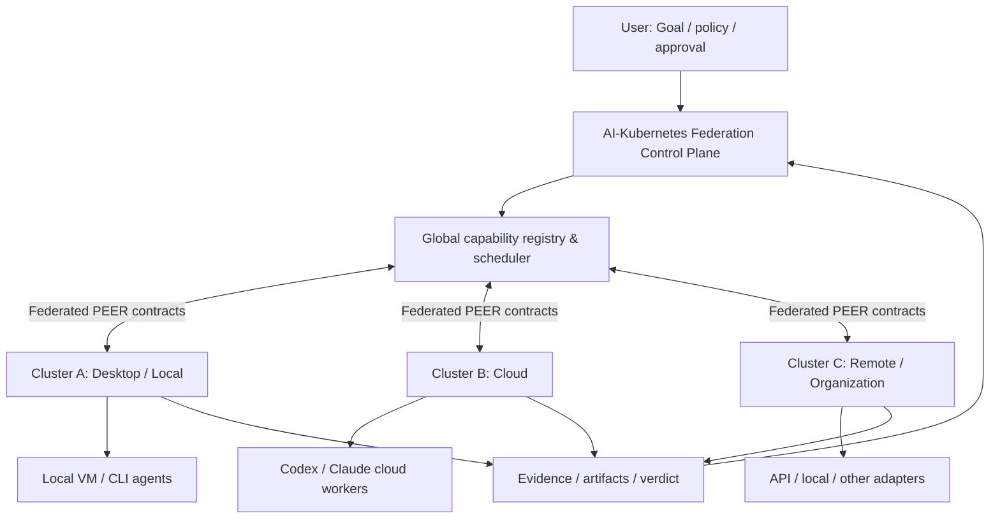

# AI-Kubernetes

> **Federated, vendor-neutral AI agent compute orchestration**  
> 필요한 지능 자원을 장착하고, 필요한 만큼 확장하고, 작업이 끝나면 반환한다.

**AI-Kubernetes**는 OpenAI, Anthropic, 기타 API·CLI·Cloud 세션·로컬 모델 등 이질적인 AI 실행 자원을 하나의 **논리적 워커 풀**로 관리하고, 독립 작업을 분산 실행하며, **클러스터끼리도 PEER로 연결**하기 위한 초기 설계 프로젝트다.

단순한 LLM API 라우터나 새로운 subagent 프레임워크가 아니다. **작업 계약 → 자원 탐색 → 배치 → 실행 → 결과 회수 → 검증 → 자원 반환**을 벤더와 실행 위치에 종속되지 않게 만드는 상위 제어 계층을 지향한다.

> **상태: 설계·개발 태스크 수립(Pre-implementation).** 첫 제품은 **Windows GUI**로 제공한다. 멀티벤더 인증 관리와 **총괄 에이전트의 실행 모델 지정**을 필수 기능으로 구체화했다. 개발 장부는 작성됐으며 제품 기능의 구현·연동·출시 검증은 앞으로 진행한다.

[개발 계획·검토](docs/development-plan.ko.md) · [전체 개발 태스크](docs/development-backlog.ko.md) · [SQLite 장부](planning/backlog.sqlite3) · [최초 설계문서](docs/initial-design.ko.md) · [Agent Governance Suite](https://github.com/jaeseongs95/agent-governance-suite) · [VibeMarshal](https://github.com/jaeseongs95/vibemarshal)

## 첫 제품의 사용자 경험

1. **멀티벤더 인증 공간:** GUI에서 여러 벤더 계정, API 키, 지원되는 구독 호스트를 연결·확인·교체·해제한다. 실제 비밀은 Windows 사용자 저장소 또는 공식 호스트 저장소가 보관하고 앱에는 비밀 참조만 노출한다.
2. **총괄 에이전트 지정:** Dot처럼 목표를 받고 작업을 위임·회수·보고하는 총괄의 실행 자원, 모델, 지원 추론 수준과 대체 정책을 설정한다. 총괄과 worker/검토 역할의 프로필은 분리한다.
3. **Windows GUI 운영:** 목표 입력부터 자원·worker 현황, 승인 범위, 결과·근거·비용, 일시정지와 재시작 복구까지 GUI로 제공한다. GUI 창과 실행 중인 총괄/worker의 수명은 구분한다.

GUI 기술 스택, Windows 세부 지원 버전·CPU·설치 형식은 검증 태스크에서 결정한다. 기존 VibeMarshal의 GUI 자산과 EngineClient 계약을 재사용 후보로 검토한다.

## 왜 만드는가

오늘날 AI 작업은 모델·CLI·클라우드·계정별로 따로 운영되기 쉽다. 이 구조에서는 독립 테스트가 수십 개여도 사람이 세션을 직접 열고, 작업을 나누고, 결과를 수집하고, 중복·누락·비용을 확인해야 한다.

AI-Kubernetes의 목표는 **모델을 하나 더 만드는 것**이 아니라 **이미 보유하거나 합법적으로 접근 가능한 지능 자원을 통합 운영하는 것**이다.

- **장착(Attach):** 지원되는 구독 세션, API 키, 클라우드 실행 경로, 로컬 모델을 자원으로 등록한다.
- **발견(Discover):** 모델, 추론 수준, 도구, 권한, 지연, 비용, 동시성·사용량 한도를 실제 지원 범위대로 파악한다.
- **분해·배치(Schedule):** 작업 의존성을 보존하면서 서로 독립적인 일은 병렬로 분산한다.
- **검증(Verify):** 작업자의 완료 선언만으로 완료하지 않고 증거, 실행 관측, 독립 검토를 확인한다.
- **반환(Release):** 작업 종료 후 불필요한 임시 세션을 정리하고 유휴 워커를 최소화한다(scale-to-zero 지향).
- **연합(Federate):** 하나의 AI-Kubernetes 클러스터뿐 아니라 **독립 클러스터 여러 개를 PEER 통신으로 연결**한다.

## 핵심 원칙

1. **벤더 독립:** 컨트롤 플레인은 특정 모델 공급자의 인증 형식이나 세션 구현에 종속되지 않는다.
2. **실행 능력 중심:** 공급자가 아닌 capability, 정책, 한도, 가용성으로 자원 배치를 결정한다.
3. **구독·API 모두 자원:** 사용자가 지원되는 방법으로 연결한 **구독 기반 호스트 세션**과 **API 자격증명**을 모두 다루되, 둘을 동일한 인증 권한으로 간주하지 않는다.
4. **분산보다 거버넌스 우선:** ACK, 권한, 완료 판정, 증거, 원장과 복구 절차가 실행 경로를 뒷받침한다.
5. **최대 병렬화가 아니라 제약 내 최적 병렬화:** 작업 DAG, 동시성, 예산, rate limit, 서비스 약관, 데이터 정책을 먼저 만족해야 한다.
6. **다중 클러스터 연합:** 각 클러스터는 독립적으로 운영하고, 상위 연합은 능력·잔여 용량·작업 계약을 통해 협력한다.
7. **실패를 숨기지 않음:** 전송 확인, 처리 확인, 실행 성공, 검증 통과, 최종 완료를 구분한다.

## 구조



각 클러스터는 공통 인터페이스를 제공하되 내부 구현, 공급자 인증정보, 로컬 정책과 상세 작업 원장은 외부에 공개하지 않는다. 연합 레벨은 **어느 클러스터에 맡길지**, 로컬 레벨은 **그 클러스터의 어떤 워커에 맡길지** 결정한다.

### 프로젝트 간 역할

| 구성 요소 | 책임 |
| --- | --- |
| **AI-Kubernetes** | 클러스터 연합, 자원 등록·광고, 자원 할당(lease), 전역 배치, 오토스케일, 공급자 adapter 관리 |
| **[VibeMarshal (VM)](https://github.com/jaeseongs95/vibemarshal)** | Goal Contract, Task DAG, 계획/승인 경계, 실행·관측·검증·복구의 권위 워크플로 |
| **[Agent Governance Suite (AGS)](https://github.com/jaeseongs95/agent-governance-suite)** | 세션 PEER, ACK·handoff, 작업 계약·거버넌스 검사, 문맥 연속성, 증거·독립감사 |
| **Provider / host adapters** | 벤더별 공식 실행 경로, 세션·API 호출, capabilities, 실행 결과·사용량의 표준 변환 |
| **JEV (내부 계층)** | RAW 입력을 보존한 상태에서 확인된 메타정보를 정리·분류·평가해 에이전트의 스킬 선택을 보조. 최종 선택권은 에이전트에게 있음 |

VM과 AGS의 **현재 구현 상태는 각 원본 저장소 문서가 기준**이며, AI-Kubernetes는 이들 기능을 중복 구현하는 대신 인터페이스를 연결하도록 설계한다.

## 작업 흐름 예시

사용자가 다음 목표를 입력했다고 가정한다.

> “서로 독립적인 검증 사례 39개를 실행하고, 실패 사례를 구분해 근거와 함께 보고해.”

1. VM이 목표·허용 작업·완료 기준을 명확히 하고 Task DAG와 실행 후보를 만든다.
2. AI-Kubernetes가 각 클러스터의 capability, 할당 가능한 워커, 예산·쿼터·실행 제약을 조회한다.
3. 독립 작업만 병렬 배치한다. 선행 조건이 있는 작업은 준비 또는 대기 상태를 유지한다.
4. 각 worker는 격리된 입력으로 실행하고 결과·사용량·증거를 반환한다.
5. AGS 거버넌스와 VM 검증 계약에 따라 미완료·실패·불확실한 결과를 구분한다.
6. 결과를 취합하고, 필수 검토·승인 후 최종 완료 판정을 생성한다.
7. 임시 worker의 lease를 해제하고 가능한 실행환경을 종료한다.

**39개 작업 = 반드시 39개 세션**이라는 뜻은 아니다. 병렬도는 각 작업의 독립성, 공급자의 실제 동시성 한도, 캐시 효율, 예산과 외부 서비스 정책을 고려해 결정한다.

## 장착 가능한 자원: 목표 모델

| 자원 유형 | 예시 | 연결 방식 |
| --- | --- | --- |
| 지원되는 구독 호스트 | Codex CLI/Cloud, Claude Code/Cloud | 공식 호스트·세션 연결 인터페이스 및 허용된 사용자 권한 |
| 상용 API | OpenAI API, Anthropic API, 기타 호환 제공자 | 해당 제공자의 API 키/조직 설정 |
| 로컬 추론 | 로컬 LLM 서버, 온디바이스 모델 | 로컬 adapter·명시적 자원 한도 |
| 원격 클러스터 | 다른 AI-Kubernetes 설치 | 인증된 federation PEER |

**구독 결제와 API 요금은 서로 독립적일 수 있다.** 구독 자격증명을 API 키로 재사용하거나, 비공식 인증·약관 우회를 전제하지 않는다. 지원하지 않는 경로는 등록할 수 있어도 **실행 불가**로 표시한다.

## 최초 릴리스 목표

- Windows 설치본에서 여러 벤더의 API 및 지원 구독 호스트를 등록하고 시크릿 수명주기를 관리한다.
- 사용자가 지정한 총괄 모델이 목표를 받아 **서로 다른 두 벤더의 qualified 자원**에 VM의 독립 Task를 배치한다.
- AGS gate와 VM validation/verdict를 통과해 결과·근거·실제 모델·사용량을 회수한다.
- 모든 핵심 작업을 GUI에서 수행하고 일시정지·취소·창 재열기·재시작 때 기존 실행을 복구한다.
- 설치·업데이트·비밀 경계·장애 복구·독립 검토를 동일 배포 후보에서 검증한다.

**개발 순서 제안:** 단일 클러스터 Windows 배포(M0~M4)를 먼저 검증한 뒤, **독립 클러스터 2개 간 PEER 연결·위임·결과 회수(M5)**로 확장한다. 연합은 핵심 제품 목표로 유지한다. 이 단계화는 장부의 `DEC06: proposed`로 기록했으며, 사용자가 확정한 Windows/GUI 요구와 구분한다.

## 개발 장부

`planning/backlog.sqlite3`가 개발 태스크 정본이다. 요구사항·출처·단계·우선순위·담당 구성요소·의존성·완료 기준·검증 방법·상태 이력·증거를 연결한다. **82개 태스크, 246개 완료 기준, 300개 의존성**을 등록했다. 초기 상태는 전부 `todo`다.

| 단계 | 범위 | 태스크 |
| --- | --- | ---: |
| M0 | 통합 계약·Windows 기반 결정 | 8 |
| M1 | 인증 보관·멀티벤더 연결 | 14 |
| M2 | 총괄·AGS/VM 실행 통합과 upstream 준비 조건 | 24 |
| M3 | Windows GUI 실제 연결 | 12 |
| M4 | Windows 첫 배포 검증 | 8 |
| M5 | 탄력 운영·원격 PEER 연합 | 11 |
| M6 | 로컬 모델·추가 벤더·조직·배포 확장 | 5 |

[전체 태스크와 완료 기준](docs/development-backlog.ko.md) · [Git에서 비교할 SQL 스냅샷](planning/backlog.sql)

장부 도구는 Python 표준 라이브러리만 사용한다. 제품 런타임과 별개다.

```bash
python tools/backlog.py validate
python tools/backlog.py list --ready
python tools/backlog.py list --milestone M1
```

유지보수·복원·상태 변경 절차는 [개발 계획](docs/development-plan.ko.md#개발-장부-사용법)에 있다.

## 설계 범위와 비범위

현재 범위는 **AI 실행 자원의 제어·연합·감사**다. 처음부터 Kubernetes 자체를 수정하거나 Kubernetes의 Pod/etcd/CNI API를 구현한다는 뜻이 아니다. 동일한 철학의 AI 전용 제어 계층을 먼저 만든다. Kubernetes 배포 지원은 추후 선택 가능한 adapter일 뿐 필수 전제가 아니다.

대규모 모델 학습, 임의 사용자 계정의 권한 공유, 공급자 제한 우회, 자동 결제, 무제한 세션 보장도 프로젝트의 목표에 포함하지 않는다.

## 프로젝트 상태

**2026-10-12 · 개발 계획 v0.2.** 최초 아키텍처를 검토하고 Windows GUI·인증 관리·총괄 모델 설정을 개발 태스크로 구체화했다. AGS/VM의 실제 설치형 호환성과 실행 관측은 선행 qualification 태스크로 추적한다. 장부 검증 통과는 제품 또는 upstream 실행 검증 통과를 의미하지 않는다.

## 라이선스

**미정.** 이 저장소에 별도의 `LICENSE`가 명시되기 전까지 AGS의 MIT 또는 VM의 Apache-2.0 라이선스가 이 프로젝트 전체에 자동 적용된다고 가정하지 않는다.
