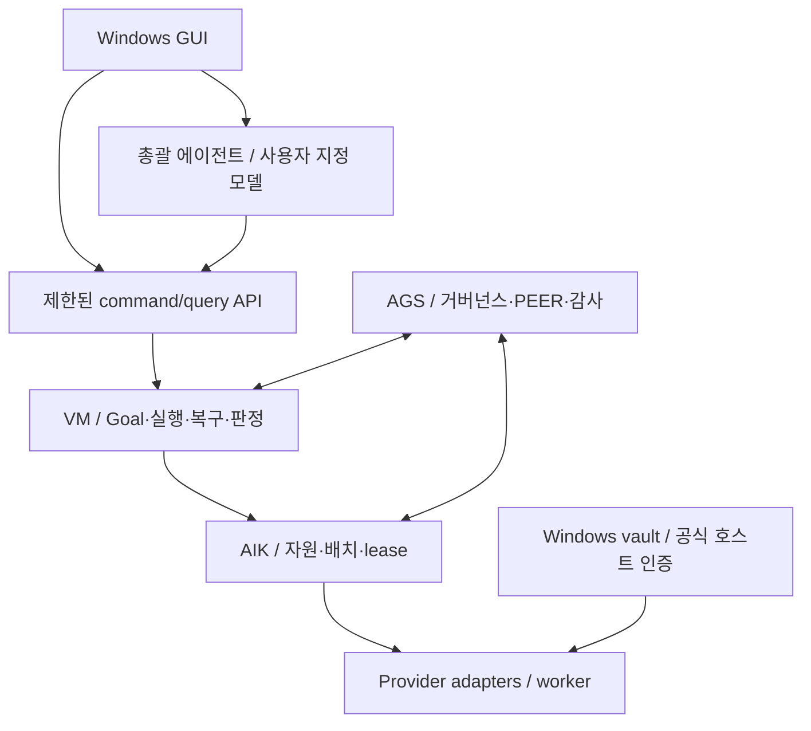

# AI-Kubernetes 개발 계획과 설계 검토

- 작성일: **2026-10-12**
- 계획 버전: **v0.2**
- 검토한 AI-Kubernetes 기준선: [`0367932ce2fa9369a3420a4867283167ea319188`](https://github.com/jaeseongs95/AI-Kubernetes/commit/0367932ce2fa9369a3420a4867283167ea319188)
- 개발 태스크 정본: [planning/backlog.sqlite3](../planning/backlog.sqlite3)
- 읽기용 전체 태스크: [development-backlog.ko.md](development-backlog.ko.md)
- Git 비교·복원용 생성본: [planning/backlog.sql](../planning/backlog.sql)
- 제품 상태: **구현 전. 이 문서와 장부 도구 작성은 제품 기능 완료가 아니다.**

## 검토 결론

기존 최초 설계는 자원 등록·lease·배치·PEER 연합과 VM/AGS 권위 경계를 이미 정의한다. 여기에 **Windows GUI 제품, 인증 관리 공간, 사용자 지정 총괄 에이전트**를 실제 개발 단위로 추가한다.

새 Goal/Task 엔진을 만드는 계획으로 확대하지 않는다. VM의 Goal/Plan/Task/Attempt 및 verdict, AGS의 거버넌스·PEER·감사 계약을 연결하고 AI-Kubernetes는 사용자 경험·자원·placement·lease를 소유한다. 최초 설계 §3의 중복 원장 금지 원칙을 유지한다. [최초 설계 기준선](https://github.com/jaeseongs95/AI-Kubernetes/blob/0367932ce2fa9369a3420a4867283167ea319188/docs/initial-design.ko.md)

## 사용자 확정 요구와 개발 판단

| 구분 | 내용 | 장부 |
| --- | --- | --- |
| 사용자 확정 | 멀티벤더 로그인·인증을 한곳에서 관리 | U01, DEC03 |
| 사용자 확정 | Dot 역할의 총괄 에이전트 모델 지정 | U02, DEC02 |
| 사용자 확정 | GUI 제공, 첫 출시 Windows 전용 | U03·U04, DEC01 |
| 이전 사용자 비전 유지 | 구독/API/로컬 자원 장착, 탄력 worker, 클러스터 간 PEER | U05~U07 |
| 기존 설계·정정 유지 | AGS/VM 책임, JEV 내부 보조·RAW 보존·AGENT 최종 선택 | U08·U09, DEC04·DEC05 |
| 개발 순서 제안 | 단일 클러스터 Windows 배포를 검증한 뒤 원격 연합 확장 | DEC06 **proposed** |
| 구현안 제안 | 사용자 범위 Windows vault와 비밀 참조 broker | DEC09 **proposed** |
| 초기 지원 범위 제안 | 두 벤더의 API/구독 연결과 역할별 실제 도구 실행; 필수/선택/미지원 matrix 확정 | DEC12 **proposed** |
| 열린 선택 | GUI 스택, Windows 세부 지원 환경·설치 형식, 라이선스, 원격 전송 규약 | DEC07·DEC08·DEC10·DEC11 **open** |

SQLite `requirements.origin`은 `user`와 `derived`를 구분한다. `sources`는 사용자 요구, 고정 SHA의 저장소 내용, 공식 문서를 구분한다. `decisions.status`는 `confirmed`, `proposed`, `open`으로 관리한다. 구현 선택을 사용자 확정 사항으로 기록하지 않는다.

## 1. 멀티벤더 인증 관리 공간

사용자가 여러 계정과 실행 경로를 한 화면에서 장착한다. 같은 벤더라도 구독 호스트와 API 키는 별도 연결이며, 같은 모델을 제공해도 사용량·도구·취소·관측 지원은 실행 경로별로 관리한다.

### 개발 범위

- **연결 프로필:** 계정 별칭, provider, 인증 유형, 실행 경로, 연결 상태, `connection_id`, `credential_ref`, 최종 확인 시각, 사용 workspace.
- **Windows 시크릿 저장소:** API 키의 저장·조회·교체·삭제, 사용자 범위 보호, 잠금·재인증·복구.
- **지원 구독 인증:** GUI가 공식 호스트 인증을 시작하고 상태·세션 참조를 회수한다. 공식 호스트가 가진 비밀은 해당 호스트에 유지한다.
- **실행 시점의 비밀 제공:** 인가된 adapter만 필요한 연결의 비밀을 해석한다. 총괄·worker·PEER에는 참조를 전달한다.
- **관측과 삭제:** 로그인 성공과 실제 실행 가능 상태를 분리하고, 키 교체·로그아웃 때 진행 중 작업을 대조한다.
- **실제 계정 바인딩:** 선택한 연결과 인증 호스트의 계정 문맥을 실행 전에 대조한다. 외부 로그인 변경은 stale/재연결로 처리하고 계정 격리 불가 호스트의 동시 충돌을 막는다.

Windows Credential Manager와 사용자 범위 DPAPI를 backend 후보로 검증한다. Microsoft 문서는 DPAPI의 일반적인 사용자 로그인 경계와 Credential Manager의 사용자 자격 증명 보관을 설명한다. 구체 backend는 AIK-009에서 결정하며 Windows 머신 전체 공유 범위를 기본값으로 사용하지 않는다. [CryptProtectData](https://learn.microsoft.com/en-us/windows/win32/api/dpapi/nf-dpapi-cryptprotectdata) · [CredWrite](https://learn.microsoft.com/en-us/windows/win32/api/wincred/nf-wincred-credwritea)

제품 runtime DB에는 비밀 참조와 metadata만 둔다. **이 저장소의 개발 장부에는 실제 계정, API 키, 로그인 토큰, runtime 작업 데이터를 넣지 않는다.**

관련 태스크: **AIK-009~022, AIK-046~048**. 첫 구현 대상으로 OpenAI/Anthropic API와 지원되는 Codex/Claude Code 구독 호스트를 계획했다. 모델 이름과 실지원 기능은 구현 시 계정·호스트별 조회 및 qualification 결과로 결정한다.

초기 provider/runtime/역할 범위는 `DEC12: proposed`다. AIK-001에서 첫 출시의 필수·선택·미지원 조합을 명시한다. 개별 경로의 미지원 상태를 다른 qualified 자원의 상태와 섞지 않는다. API 자원도 단순 모델 호출을 넘어 **도구 요청→권한 gateway→허용 도구 실행→결과 반환→후속 모델 호출**을 AIK-035/044/059에서 검증한다.

## 2. 총괄 에이전트 모델 지정과 지속 운영

총괄은 사용자 목표와 추가 지시를 받고, VM에 계획·실행을 요청하고, AGS/VM 상태와 근거를 회수해 보고한다. 이를 위해 모델 선택 화면 외에 bootstrap·이벤트 큐·문맥 복원·worker 배치·중단·권한 전달이 필요하다.

| 프로필 필드 | 의미 |
| --- | --- |
| 실행 자원 | 어느 연결·provider·host로 총괄을 실행할지 |
| 모델·추론 수준 | 해당 자원에서 검증된 model/effort 조합 |
| 도구·역할 | 총괄에 허용된 command와 scope |
| 한도 | 호출·토큰·금액·시간 및 제어용 여유 용량 |
| 대체 정책 | 사용자가 지정한 대체 프로필과 적용 조건 |
| 판본·관측 | 요청 profile revision, 실제 runtime binding, 관측 모델·effort |

총괄과 worker/검토 역할의 프로필은 독립적이다. 총괄 모델 변경으로 worker 설정을 덮어쓰지 않는다. fallback도 도구·품질·데이터·예산 범위를 확인하고 원래 Goal/Task identity를 이어간다.

총괄이 자기 완료 선언으로 VM 원장을 수정할 수는 없다. 실제 Goal/Task 완료는 VM Core의 verdict와 필요한 AGS gate를 따른다. 사용자가 이미 허용한 작업은 기존 인가 범위를 전달하고, 새로운 범위 판단이 필요한 경우에만 해당 근거를 GUI에 제시한다.

JEV는 AGS/VM 내부 분류·평가 보조 계층으로 연결한다. 사용자 RAW는 보존하고 앞단에서 별도 LLM을 호출해 정형화하지 않는다. 최종 스킬 선택은 실제 AGENT가 수행한다. 모델/worker placement와 스킬 선택은 별도 결정이다.

내부 계층이라는 설계는 확정 원칙이다. 실제 사용 가능한 JEV 입출력 계약·버전·배포 상태는 AIK-030에서 확인하며, 구현이 미완료인 부분은 upstream 참조와 차단 조건으로 기록한다.

관련 태스크: **AIK-023~030, AIK-049~050**. backend 및 engine 연결은 **AIK-031~044, AIK-081~082**다.

## 3. Windows GUI 제품 구조



GUI는 비권위 클라이언트이며 같은 command/query 계약을 총괄도 사용한다. 이 그림의 각 컴포넌트는 책임 구분이고 실제 프로세스 수는 AIK-002/004에서 결정한다.

| 화면 | 사용자 작업 | 태스크 |
| --- | --- | --- |
| 첫 연결 | 벤더 선택·공식 로그인·API 키 등록 | AIK-046 |
| 인증 공간 | 연결 검사·회전·로그아웃·재인증·삭제 | AIK-047 |
| 자원·모델 | 실행 경로·지원 모델·도구·상태 확인 | AIK-048 |
| 총괄·역할 설정 | 총괄/worker 모델과 effort·대체 정책 지정 | AIK-049 |
| 총괄 대화 | 목표·추가 지시·진행 보고·재개 | AIK-050 |
| Goal·Task | 계획·의존성·상태·대기 사유 | AIK-051 |
| worker 현황 | 실제 모델·effort·host·lease·중단 | AIK-052 |
| 사용자 판단 | 범위와 근거가 구체적인 승인·추가 입력 | AIK-053 |
| 산출물·근거 | 파일·digest·validation·감사·진단 | AIK-054 |
| 사용량·한도 | 총괄/worker 비용·quota·한도 | AIK-055 |
| 트레이·설정 | 창 닫기·백그라운드·종료·한글·접근성 | AIK-056 |

GUI를 닫는 것과 worker를 취소하는 것은 별도 동작으로 정의한다. 다시 열면 같은 supervisor/목표에 연결한다. Windows 재시작 후에는 기존 provider job을 먼저 관측하여 중복 발사를 막는다.

VM GUI의 Tauri 2+React/TypeScript+Python sidecar 제안과 기존 UI 자산을 검토하되 AI-Kubernetes 스택으로 자동 확정하지 않는다. 지원 Windows 버전·CPU 아키텍처·installer·서명 방식도 검증을 거쳐 결정한다. [VM GUI 설계 기준선](https://github.com/jaeseongs95/vibemarshal/blob/32bb0f9dd9f024045d24487312b50f5b703573a3/docs/gui-interface-design.md)

## 4. 기존 프로젝트 검토 결과와 선행 조건

이번 검토는 저장소 파일·문서·패키지 metadata를 읽은 결과다. 제품 코드를 실행하거나 upstream 테스트를 수행하지 않았다.

| 대상 | 확인한 기준선 | 확인 내용 | 개발 반영 |
| --- | --- | --- | --- |
| AI-Kubernetes | `0367932ce2fa9369a3420a4867283167ea319188` | README·최초 설계 2개; 제품 코드 없음 | 신규 제품·연동 태스크로 등록 |
| AGS | `56fef8bd189377b80f4020f506e717ab292b260a` | README는 2.9.0 공개 준비 및 기본 동일 컴퓨터/OS 사용자 범위 설명 | 원격 PEER를 별도 확장으로 개발 |
| VM | `32bb0f9dd9f024045d24487312b50f5b703573a3` | README는 0.2.0a1, schema4·RuntimeJob·façade 구현 명시; 1.0 NO-GO | façade 재사용과 설치형 qualification |
| VM GUI | 같은 VM SHA | `MockEngineClient` 기반, 실제 Engine/SQLite 미연결 | 실 backend 연결·Windows 설치본 E2E |
| AGS/VM gate | 같은 기준선 | VM README에 A2 적합성 전환·호환 plugin release 미완료 명시 | AIK-008·081·032를 선행조건으로 연결 |
| 모델 관측 | 같은 기준선 | VM README에 Codex turn별 model/effort 관측 부재와 `GOVERNANCE_PROVIDER_UNSUPPORTED` 명시 | AIK-082 qualification 후 실행 가능 광고 |

출처: [AGS README](https://github.com/jaeseongs95/agent-governance-suite/blob/56fef8bd189377b80f4020f506e717ab292b260a/README.md) · [AGS 실행 관측 계약](https://github.com/jaeseongs95/agent-governance-suite/blob/56fef8bd189377b80f4020f506e717ab292b260a/docs/host-execution-attestation.md) · [VM README](https://github.com/jaeseongs95/vibemarshal/blob/32bb0f9dd9f024045d24487312b50f5b703573a3/README.md)

VM GUI handshake 예시의 schema2와 현재 README의 schema4, 일부 freeze/qualification 상태 서술에는 차이가 있다. 설치형 contract와 실제 receipt로 확인하는 AIK-001/008에 반영했다. AGS root의 manifest를 읽지 못한 사실만으로 배포물에 manifest가 없다고 단정하지 않는다. 설치형 artifact의 경로와 소비 표면을 직접 점검한다.

**AIK-081/082는 upstream 준비 조건을 추적하는 통합 태스크**다. AI-Kubernetes에서 거버넌스 gate를 생략하거나 기존 엔진을 다시 작성하여 통과 처리하지 않는다. 해당 경로의 수정·호환 artifact·검증 근거를 확보해야 완료할 수 있다.

VM의 기존 conformance 결과/cache와 gate 공개 경로를 소비한다. 또한 기준선 VM은 qualification 전 동일 프로젝트의 Attempt를 직렬 실행하도록 명시한다. AIK-033/041은 이 제약을 우선 적용하며 해당 실행 경로의 동시성 qualification 근거를 확보한 경우에만 병렬 배치를 허용한다. 첫 두 벤더 연결 E2E와 실제 병렬 성능 qualification은 구분해 기록한다. [VM README 실행 경계](https://github.com/jaeseongs95/vibemarshal/blob/32bb0f9dd9f024045d24487312b50f5b703573a3/README.md)

evidence를 표시용으로 정제할 때는 원본 identity/digest를 덮지 않는다. 별도 derivative identity와 digest·변환 provenance를 연결한다. 원본 보관이 정책상 허용되지 않으면 처음부터 비밀 없는 근거를 생산하도록 AIK-037에 반영했다.

## 5. 개발 단계와 우선순위

| 단계 | 범위 | 수 | 종료 기준 |
| --- | --- | ---: | --- |
| M0 | 통합 계약·Windows 기반 결정 | 8 | 소유권·실제 인터페이스·지원 환경·GUI/IPC·저장 기반 확정 |
| M1 | 인증·멀티벤더 자원 | 14 | vault 및 두 벤더 API/지원 구독 경로 검증 |
| M2 | 총괄·실행·검증·회수 | 24 | 실제 총괄→VM→AGS→두 벤더의 단일 클러스터 E2E |
| M3 | GUI 실제 연결 | 12 | 연결·총괄 지정·목표 운영·근거 확인·재접속을 GUI로 수행 |
| M4 | Windows 첫 배포 | 8 | 설치본 E2E·실패 복구·독립 검토·서명/무결성 |
| M5 | 탄력 운영·원격 연합 | 11 | 독립 두 클러스터 위임·결과·단절 회복·측정 |
| M6 | 추가 자원·조직·배포 | 5 | 로컬 LLM·추가 provider·정책 템플릿·조직·선택적 K8s |

M0~M4의 **66개**가 현재 제안한 첫 Windows 배포 범위다. M5의 **11개**는 원격 연합과 운영 확장이고, M6의 **5개**는 추가 자원 확장이다. 단계 순서는 `DEC06: proposed`이며 독립 작업의 실제 착수 가능 여부는 `task_dependencies`가 결정한다. 예를 들어 로컬 모델 adapter는 첫 배포 검증 뒤 원격 연합과 병렬 착수할 수 있도록 직접 의존성만 둔다.

**P0:** 핵심 계약·기능·출시 gate. **P1:** 운영 품질·후속 기능. **P2:** 추가 확장. 우선순위는 착수 순서를 조정하는 값이며, 선택한 milestone의 P1을 자동으로 생략하는 뜻이 아니다. 완료 기준과 의존성을 만족해야 해당 milestone을 종료한다.

당장 선행 작업 없이 착수할 수 있는 항목은 다음 세 개다.

1. **AIK-001:** AGS·VM 책임·설치형 인터페이스 기준선.
2. **AIK-002:** Windows GUI 스택과 엔진 sidecar spike.
3. **AIK-003:** Windows 지원 환경·설치·서명 방식.

## 6. 개발 장부 구조

| 테이블 | 기록하는 내용 |
| --- | --- |
| `tasks` | ID·제목·설명·산출물·검증 방법·epic·milestone·우선순위·상태·담당 구성요소·순서·시각 |
| `acceptance_criteria` | 각 태스크의 관찰 가능한 완료 기준 |
| `task_dependencies` | 선행 작업 관계 |
| `requirements`, `task_requirements` | 사용자/파생 요구와 작업의 연결 |
| `sources`, `task_sources` | 사용자·저장소·공식 자료와 기준 SHA |
| `decisions`, `task_decisions` | 확정·제안·열린 결정과 관련 작업 |
| `milestones`, `epics` | 단계와 기능군 |
| `task_events` | 작업 생성·상태 변경 이력 |
| `task_evidence` | 완료 근거의 참조와 요약 |
| `metadata` | schema·기준선·작성 시각·소유권 및 정본 정책 |

현재 **82개 태스크, 17개 요구사항(사용자 9·파생 8), 12개 결정, 12개 출처, 246개 완료 기준, 300개 의존성**이다. 태스크당 완료 기준은 3개다. 초기 상태는 모두 `todo`이고 실제 완료 증거는 0개다. `created`와 `review_refined` 이력은 장부 등록 및 설계 검토 사실만 나타낸다.

`v_backlog`는 작업별 선행 잔여 수·기준 수·증거 수를 보여준다. `v_ready_tasks`는 `todo`이면서 모든 선행 작업이 `done`인 항목이다. `v_milestone_summary`는 단계별 상태·착수 가능 수를 집계한다.

## 개발 장부 사용법

Python 표준 라이브러리만 사용하며 제품 runtime을 설치하거나 실행하지 않는다. 아래 명령은 저장소 루트 기준이다.

```bash
# 무결성·외래키·순환·필수 메타정보·범위 역전·완료 근거 검증
python tools/backlog.py validate

# 다음 착수 가능한 태스크와 단계별 목록
python tools/backlog.py list --ready
python tools/backlog.py list --milestone M1

# 상태와 이력을 같은 트랜잭션으로 기록
python tools/backlog.py status AIK-001 in_progress --note "설치형 인터페이스 조사 시작"

# DB에서 SQL 및 읽기용 보고서 재생성
python tools/backlog.py export
python tools/backlog.py report

# 기존 DB를 덮어쓰지 않고 SQL에서 새 파일로 복원
python tools/backlog.py restore --source planning/backlog.sql --output /absolute/path/backlog-restored.sqlite3
python tools/backlog.py --db /absolute/path/backlog-restored.sqlite3 validate
```

Windows에서는 복원 경로로 `C:/work/backlog-restored.sqlite3`처럼 원하는 새 경로를 사용한다. `--db`로 다른 사본을 지정할 수 있다.

태스크의 요구·산출물·기준·의존성을 수정할 때는 SQLite 정본을 변경한 뒤 `validate`, `export`, `report`를 실행한다. Git에는 SQLite와 SQL/Markdown 생성본을 함께 반영한다. `schema.sql`은 새 장부의 구조 정의이고, `backlog.sql`은 데이터까지 포함한 생성 스냅샷이다. SQL 스냅샷 또는 보고서만 수동 편집해 정본과 다르게 만들지 않는다.

실제 완료 시 `task_evidence`에 코드/커밋/검증 결과의 참조·요약·시각을 먼저 기록하고 모든 완료 기준을 검토한 뒤 상태를 `done`으로 변경한다. 도구는 증거 존재·선행 완료·기준 개수와 DB 관계를 확인한다. **증거 내용이 충분한지와 제품이 기준을 만족하는지는 실제 검토로 판정한다.**

```sql
-- 사용자 요구별 개발 범위
SELECT r.id, r.title, t.id, t.title, t.status
FROM requirements r
JOIN task_requirements tr ON tr.requirement_id = r.id
JOIN tasks t ON t.id = tr.task_id
WHERE r.id IN ('U01', 'U02', 'U03', 'U04')
ORDER BY r.id, t.sequence;

-- 첫 배포의 남은 작업
SELECT id, title, priority, status, open_dependency_count
FROM v_backlog
WHERE milestone_scope = 'first_release' AND status <> 'done'
ORDER BY sequence;

-- 아직 완료되지 않은 선행 작업
SELECT d.task_id, d.depends_on, p.title, p.status
FROM task_dependencies d JOIN tasks p ON p.id = d.depends_on
WHERE p.status <> 'done'
ORDER BY d.task_id, d.depends_on;
```

DB와 SQL/Markdown은 서로 다른 파일이다. 상태 변경 후 스냅샷 생성이 실패하면 도구가 정본 반영 여부와 재생성 명령을 알린다. 정본의 최신 변경을 보존한 채 `export`/`report`로 복구한다. 여러 작업자가 병렬로 장부를 수정할 때는 같은 DB 파일에 별도 Git 변경을 덮어쓰지 말고 사본의 변경을 검토·병합한 뒤 생성본을 다시 만든다.

## 검증 범위

이 변경에서는 **개발 장부와 장부 유지보수 도구**를 검증한다. SQLite `integrity_check`, 외래키, 중복/순환 의존성, 첫 배포→후속 단계 역전, 누락 요구/출처/완료 기준, 근거 없는 완료 전환, SQL 복원과 원본 보전 등을 확인한다.

Windows 제품 설치, 실제 벤더 로그인, 모델 실행, AGS/VM gate, 원격 클러스터 E2E는 이 변경의 실행 결과가 아니며 각각 장부의 미완료 개발/검증 태스크다.
