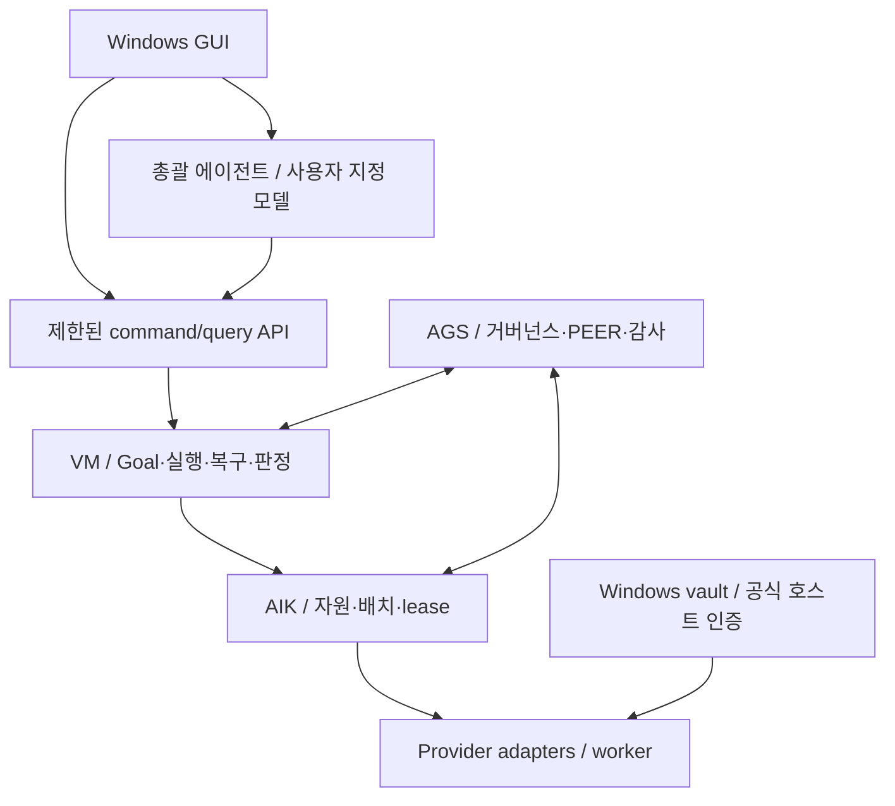

# AI-Kubernetes 개발 계획과 설계 검토

- 작성일: **2026-10-12**
- 계획 버전: **v0.4 · 태스크→완제품 완료성 검토 반영**
- 완료성 감사 기준선: [`dc6d60b67c0ccd2e56849992440de2eb639aa36c`](https://github.com/jaeseongs95/AI-Kubernetes/commit/dc6d60b67c0ccd2e56849992440de2eb639aa36c)
- 완료성 반례·수정·재검증: [완제품 완료성 보고서](product-completeness.ko.md)
- 이전 장부 도구 감사: [v0.3 감사 보고서](audit-2026-10-12.ko.md)
- 검토한 AI-Kubernetes 기준선: [`0367932ce2fa9369a3420a4867283167ea319188`](https://github.com/jaeseongs95/AI-Kubernetes/commit/0367932ce2fa9369a3420a4867283167ea319188)
- 개발 태스크 정본: [planning/backlog.sqlite3](../planning/backlog.sqlite3)
- 읽기용 전체 태스크: [development-backlog.ko.md](development-backlog.ko.md)
- Git 비교·복원용 생성본: [planning/backlog.sql](../planning/backlog.sql)
- 제품 상태: **AIK-001·002 기반 구현 완료, AIK-003의 깨끗한 Windows 클라이언트 검증은 차단 상태.** 실제 설치 GUI·worker·DPAPI, Electron·Tauri 비교, PowerShell 5.1 전달 패키지 및 설치형 연동 계약 근거는 [구현 기록](implementation-2026-10-12.ko.md)에 있다. 전체 제품 기능·출시는 미완료다.

## 검토 결론

기존 최초 설계는 자원 등록·lease·배치·PEER 연합과 VM/AGS 권위 경계를 이미 정의한다. 여기에 **Windows GUI 제품, 인증 관리 공간, 사용자 지정 총괄 에이전트**를 실제 개발 단위로 추가한다.

v0.4는 사용자가 태스크를 따라 개발했을 때 실제 설치·사용·결과 인계·복구·출시까지 닫히는지 검토한 판본이다. 기존 읽기 중심 live 기준을 **실제 사용자 프로젝트의 A/B→C 생성·수정·독립 검증 실패 후 재작업**으로 보강하고, 개별 도구 효과·결과 수명·일관 백업·GUI 유지보수·후속 배포를 연결했다. 구체 인수 흐름 P01~P12는 현재 SQLite에 기록돼 있다.

새 Goal/Task 엔진을 만드는 계획으로 확대하지 않는다. VM의 Goal/Plan/Task/Attempt 및 verdict, AGS의 거버넌스·PEER·감사 계약을 연결하고 AI-Kubernetes는 사용자 경험·자원·placement·lease를 소유한다. 최초 설계 §3의 중복 원장 금지 원칙을 유지한다. [최초 설계 기준선](https://github.com/jaeseongs95/AI-Kubernetes/blob/0367932ce2fa9369a3420a4867283167ea319188/docs/initial-design.ko.md)

## 사용자 확정 요구와 개발 판단

| 구분 | 내용 | 장부 |
| --- | --- | --- |
| 사용자 확정 | 멀티벤더 로그인·인증을 한곳에서 관리 | U01, DEC03 |
| 사용자 확정 | Dot 역할의 총괄 에이전트 모델 지정 | U02, DEC02 |
| 사용자 확정 | GUI 제공, 첫 출시 Windows 전용 | U03·U04, DEC01 |
| 이전 사용자 비전 유지 | 구독/API/로컬 자원 장착, 탄력 worker, 클러스터 간 PEER | U05~U07 |
| 기존 설계·정정 유지 | AGS/VM 책임, JEV 내부 보조·RAW 보존·AGENT 최종 선택 | U08·U09, DEC04·DEC05 |
| 개발 순서 제안 | 단일 클러스터 Windows 배포를 검증한 뒤 원격 연합 확장 | DEC06 **proposed** |
| 구현안 제안 | 사용자 범위 Windows vault와 비밀 참조 broker | DEC09 **proposed** |
| 초기 지원 범위 제안 | 두 벤더의 API/구독 연결과 역할별 실제 도구 실행; 필수/선택/미지원 matrix 확정 | DEC12 **proposed** |
| 제품 인수·출시 제안 | P01~P12, 같은 판본의 실제 검증, 선택 확장의 실제 gate 선행 연결 | DEC13 **proposed** |
| 구현 기술 결정 | 실제 Windows 후보 비교를 마치고 Electron·React/TypeScript·Python sidecar 선택; 사용자가 GUI 기술을 직접 지정한 요구와 구분 | DEC07 **confirmed**, 저장소·CI 근거 |
| Windows 지원·설치 후보 | Windows 11 x64·사용자별 NSIS·runtime 포함; 깨끗한 클라이언트에서의 설치 검증이 남음 | DEC08 **proposed** |
| 열린 선택 | 라이선스, 원격 전송 규약 | DEC10·DEC11 **open** |

SQLite `requirements.origin`은 `user`와 `derived`를 구분한다. `sources`는 사용자 요구, 고정 SHA의 저장소 내용, 공식 문서를 구분한다. `decisions.status`는 `confirmed`, `proposed`, `open`으로 관리한다. 구현 선택을 사용자 확정 사항으로 기록하지 않는다.

## 1. 멀티벤더 인증 관리 공간

사용자가 여러 계정과 실행 경로를 한 화면에서 장착한다. 같은 벤더라도 구독 호스트와 API 키는 별도 연결이며, 같은 모델을 제공해도 사용량·도구·취소·관측 지원은 실행 경로별로 관리한다.

### 개발 범위

- **연결 프로필:** 계정 별칭, provider, 인증 유형, 실행 경로, 연결 상태, `connection_id`, `credential_ref`, 최종 확인 시각, 사용 workspace.
- **Windows 시크릿 저장소:** API 키의 저장·조회·교체·삭제, 사용자 범위 보호, 잠금·재인증·복구.
- **지원 구독 인증:** GUI가 공식 호스트 인증을 시작하고 상태·세션 참조를 회수한다. 공식 호스트가 가진 비밀은 해당 호스트에 유지한다.
- **실행 시점의 비밀 제공:** 인가된 adapter만 필요한 연결의 비밀을 해석한다. 총괄·worker·PEER에는 참조를 전달한다.
- **관측과 삭제:** 로그인 성공과 실제 실행 가능 상태를 분리하고, 키 교체·로그아웃 때 진행 중 작업을 대조한다.
- **실제 계정 바인딩:** 선택한 연결과 인증 호스트의 계정 문맥을 실행 전에 대조한다. 외부 로그인 변경은 stale/재연결로 처리하고 계정 격리 불가 호스트의 동시 충돌을 막는다.

Windows Credential Manager와 사용자 범위 DPAPI를 backend 후보로 검증한다. Microsoft 문서는 DPAPI의 일반적인 사용자 로그인 경계와 Credential Manager의 사용자 자격 증명 보관을 설명한다. 구체 backend는 AIK-009에서 결정하며 Windows 머신 전체 공유 범위를 기본값으로 사용하지 않는다. [CryptProtectData](https://learn.microsoft.com/en-us/windows/win32/api/dpapi/nf-dpapi-cryptprotectdata) · [CredWrite](https://learn.microsoft.com/en-us/windows/win32/api/wincred/nf-wincred-credwritea)

**저장 보호·앱 접근 통제·OS 실행 신뢰를 구분한다.** CredRead는 현재 token의 로그온 세션에 연결된 사용자 자격 증명을 읽고, DPAPI의 일반적인 복호화 경계도 사용자 로그온 자격이다. 따라서 앱의 broker scope 검사만으로 동일 OS 사용자 native 프로세스의 직접 저장소 접근이 격리된다고 가정하지 않는다. 기존 native 경로는 실제 principal·권한·`trusted same-user` 여부를 기록하고, 제한 도구를 사용하는 API 경로 및 별도 검증된 격리 capability와 구분한다. AIK-004/009/018/035/061이 이 보장 범위를 선언하고 합성 비밀로 실제 Windows 경계를 검증한다. [CredRead](https://learn.microsoft.com/en-us/windows/win32/api/wincred/nf-wincred-credreada) · [VM의 A2 신뢰 경계](https://github.com/jaeseongs95/vibemarshal/blob/32bb0f9dd9f024045d24487312b50f5b703573a3/README.md)

제품 runtime DB에는 비밀 참조와 metadata만 둔다. **이 저장소의 개발 장부에는 실제 계정, API 키, 로그인 토큰, runtime 작업 데이터를 넣지 않는다.**

관련 태스크: **AIK-009~022, AIK-046~048**. 첫 구현 대상으로 OpenAI/Anthropic API와 지원되는 Codex/Claude Code 구독 호스트를 계획했다. 모델 이름과 실지원 기능은 구현 시 계정·호스트별 조회 및 qualification 결과로 결정한다.

초기 provider/runtime/역할 범위는 `DEC12: proposed`다. AIK-001에서 첫 출시의 필수·선택·미지원 조합을 명시한다. 개별 경로의 미지원 상태를 다른 qualified 자원의 상태와 섞지 않는다. API 자원도 단순 모델 호출을 넘어 **도구 요청→권한 gateway→허용 도구 실행→결과 반환→후속 모델 호출**을 AIK-035/044/059에서 검증한다.

### 어댑터 구현과 실제 지원 판정

adapter 구현, 실제 사전 probe, 운영 적합성, 사용자 목표와 설치본의 완료를 다음과 같이 구분한다. 구현 태스크가 아직 만들지 않은 후행 qualification의 성공을 먼저 요구하지 않도록 한다.

| 작업 | 완료의 의미 | 완료만으로 주장할 수 없는 것 |
| --- | --- | --- |
| AIK-012~015 | adapter/bridge 코드와 성공·실패 protocol fixture 검증 | 실제 Windows 로그인·모델 실행 지원 |
| AIK-019 | 공통 연결·capability 계약의 registry 및 상태 구분 | 모든 provider의 실제 지원 |
| AIK-022 | 고정 matrix의 모든 필수 인증 경로가 실제 Windows에서 검증됨 | runtime·AGS/VM 적합성 전체 통과 |
| AIK-082 | 필수 adapter/native 최소 실제 probe의 model/effort·계정·receipt 및 계약 가능성 | 완성된 governed agent loop의 운영 적합성 |
| AIK-086 | 설치형 통합 패키지의 필수 runtime/역할/도구·route/lease·효과·기본 복구 live 검증 | 최종 GUI 설치본 출시 완료 |
| AIK-044/059/064 | 실제 의존 개발 목표·독립 재작업·GUI 인계·같은 배포 후보의 출시 증거 | 미지원 또는 미검증 경로의 지원 |

matrix는 `route_id`, provider, 인증 유형, 역할, 필수/선택, **adapter 구현 상태와 qualification 상태**, 사유·시각·근거 및 revision/digest를 가진다. 012~015는 미지원 응답만 반환하는 stub으로 완료할 수 없다. 019의 공통 개발은 모든 후보 adapter를 기다리지 않도록 의존성 4개를 제거했다. 선택 경로가 미지원이어도 다른 qualified 경로를 계속 검증할 수 있지만, **필수 경로가 미지원 또는 `NOT_RUN`이면 해당 qualification과 출시 작업은 완료할 수 없다.**

두 벤더 및 API/지원 구독·총괄/worker 실행이라는 제안 범위는 유지한다. 필수 matrix를 바꾸면 DEC12와 영향·재검증 근거를 함께 갱신한다. AIK-001에서 [지원 matrix](../contracts/upstream/support-matrix.json)의 조합·판본·현재 미실행 상태를 고정했다. 개별 조합의 인증·모델·도구 실행 qualification은 후행 태스크에서 검증하며, 개발 장부 도구가 실제 provider의 지원을 자동 판정하지 않는다.

019/033은 `implemented`, `probe_verified`, `candidate_for_qualification`, `qualified`를 구분한다. 고정 test-only candidate로 086 및 같은 계약의 후속 qualification을 시작하되 기존 인가·budget/lease·AGS A2/VM gate는 모두 적용한다. 일반 실행은 해당 역할·도구 조합에서 실제 통과한 경로만 사용한다. 미검증 자원을 운영에 광고하거나 최초 시험이 자신의 PASS를 먼저 요구하는 순환을 만들지 않는다.

## 2. 총괄 에이전트 모델 지정과 지속 운영

총괄은 사용자 목표와 추가 지시를 받고, VM에 계획·실행을 요청하고, AGS/VM 상태와 근거를 회수해 보고한다. 이를 위해 모델 선택 화면 외에 bootstrap·이벤트 큐·문맥 복원·worker 배치·중단·권한 전달이 필요하다.

| 프로필 필드 | 의미 |
| --- | --- |
| 실행 자원 | 어느 연결·provider·host로 총괄을 실행할지 |
| 모델·추론 수준 | 해당 자원에서 검증된 model/effort 조합 |
| 도구·역할 | 총괄에 허용된 command와 scope |
| 한도 | 호출·토큰·금액·시간 및 제어용 여유 용량 |
| 대체 정책 | 사용자가 지정한 대체 프로필과 적용 조건 |
| 판본·관측 | 요청 profile revision, 실제 runtime binding, 관측 모델·effort |

총괄과 worker/검토 역할의 프로필은 독립적이다. 총괄 모델 변경으로 worker 설정을 덮어쓰지 않는다. fallback도 도구·품질·데이터·예산 범위를 확인하고 원래 Goal/Task identity를 이어간다.

총괄이 자기 완료 선언으로 VM 원장을 수정할 수는 없다. 실제 Goal/Task 완료는 VM Core의 verdict와 필요한 AGS gate를 따른다. 사용자가 이미 허용한 작업은 기존 인가 범위를 전달하고, 새로운 범위 판단이 필요한 경우에만 해당 근거를 GUI에 제시한다.

JEV는 AGS/VM 내부 분류·평가 보조 계층으로 연결한다. 사용자 RAW는 보존하고 앞단에서 별도 LLM을 호출해 정형화하지 않는다. 최종 스킬 선택은 실제 AGENT가 수행한다. 모델/worker placement와 스킬 선택은 별도 결정이다.

내부 계층이라는 설계는 확정 원칙이다. 실제 사용 가능한 JEV 입출력 계약·버전·배포 상태는 AIK-030에서 확인하며, 구현이 미완료인 부분은 upstream 참조와 차단 조건으로 기록한다.

관련 태스크: **AIK-023~030, AIK-049~050**. backend 및 engine 연결은 **AIK-031~044, AIK-081~086**이다. 026은 제어 흐름과 공개 명령 연결을 구현·계약 fixture로 검사하고, 실제 모델·파일·고정 oracle의 합성 목표 성공은 044/059에서 필수로 검증한다.

## 3. Windows GUI 제품 구조



GUI는 비권위 클라이언트이며 같은 command/query 계약을 총괄도 사용한다. 이 그림의 각 컴포넌트는 책임 구분이고 실제 프로세스 수는 AIK-002/004에서 결정한다.

| 화면 | 사용자 작업 | 태스크 |
| --- | --- | --- |
| 프로젝트 | 기존 폴더 열기·생성·전환·실제 실행 root 확인 | AIK-084·087 |
| 첫 연결 | 벤더 선택·공식 로그인·API 키 등록 | AIK-046 |
| 인증 공간 | 연결 검사·회전·로그아웃·재인증·삭제 | AIK-047 |
| 자원·모델 | 실행 경로·지원 모델·도구·상태 확인 | AIK-048 |
| 총괄·역할 설정 | 총괄/worker 모델과 effort·대체 정책 지정 | AIK-049 |
| 총괄 대화 | 목표·추가 지시·진행 보고·재개 | AIK-050 |
| Goal·Task | 계획·의존성·상태·대기 사유 | AIK-051 |
| worker 현황 | 실제 모델·effort·host·lease·중단 | AIK-052 |
| 사용자 판단 | 범위와 근거가 구체적인 승인·추가 입력 | AIK-053 |
| 산출물·근거 | 실제 파일 열기·저장/내보내기·digest·validation·감사·진단 | AIK-054 |
| 사용량·한도 | 총괄/worker 비용·quota·한도 | AIK-055 |
| 트레이·설정 | 창 닫기·백그라운드·종료·한글·접근성 | AIK-056 |
| 유지보수·복구 | 설정 이동·전체 백업·업데이트 실패·새 사용자 복원 | AIK-058·088 |

GUI를 닫는 것과 worker를 취소하는 것은 별도 동작으로 정의한다. 다시 열면 같은 supervisor/목표에 연결한다. Windows 재시작 후에는 기존 provider job을 먼저 관측하여 중복 발사를 막는다.

실제 workspace root·VM project·native/API cwd와 선행 입력 bytes/digest/revision은 084가 결속한다. 개발 역할의 읽기·생성·수정·한정 검증 명령은 085, API/native 실행 연결은 035가 담당한다. 개별 tool effect의 intent/receipt·결과 반환·취소/unknown은 기존 VM 권위를 사용한다. 037/038/054는 결과 인계 뒤 worker 정리·앱 재시작 후에도 약속한 보관 범위에서 실제 파일을 사용할 수 있게 한다.

058은 각 소유자의 공개 checkpoint/복원 절차와 공통 manifest로 AIK 설정·VM 이력·AGS 근거·실제 artifact의 복구 지점을 맞춘다. 설정-only 이동과 전체 상태 복원을 구분하고 혼합 시점·누락/변조 근거·중복 효과를 거절한다. 088/059가 이 backend를 GUI와 앱이 부팅되지 않을 때의 설치 복구 화면에 연결해 실제 사용자 복원을 검증한다.

VM GUI의 Tauri 2+React/TypeScript+Python sidecar 제안과 기존 UI 자산을 검토하고, AIK-002에서 두 후보를 실제 비교한 후 AI-Kubernetes의 첫 구현 스택을 Electron으로 결정했다. 지원 Windows 클라이언트와 installer·서명 정책의 실행 검증은 AIK-003 및 각각의 후행 제품 태스크 상태를 따른다. [VM GUI 설계 기준선](https://github.com/jaeseongs95/vibemarshal/blob/32bb0f9dd9f024045d24487312b50f5b703573a3/docs/gui-interface-design.md), [현재 구현 결정](windows-packaging.ko.md)

## 4. 기존 프로젝트 검토 결과와 선행 조건

아래 표는 **최초 계획 단계**에서 저장소 파일·문서·패키지 metadata를 읽어 확인한 기준선이다. 당시에는 제품 코드나 upstream 테스트를 실행하지 않았다. 이후 AIK-001의 실제 설치형 artifact·공개 명령 검사와 Windows 기반 실행은 [구현 기록](implementation-2026-10-12.ko.md)에 별도로 보존한다.

| 대상 | 확인한 기준선 | 확인 내용 | 개발 반영 |
| --- | --- | --- | --- |
| AI-Kubernetes | `0367932ce2fa9369a3420a4867283167ea319188` | README·최초 설계 2개; 제품 코드 없음 | 신규 제품·연동 태스크로 등록 |
| AGS | `56fef8bd189377b80f4020f506e717ab292b260a` | README는 2.9.0 공개 준비 및 기본 동일 컴퓨터/OS 사용자 범위 설명 | 원격 PEER를 별도 확장으로 개발 |
| VM | `32bb0f9dd9f024045d24487312b50f5b703573a3` | README는 0.2.0a1, schema4·RuntimeJob·façade 구현 명시; 1.0 NO-GO | façade 재사용과 설치형 qualification |
| VM GUI | 같은 VM SHA | `MockEngineClient` 기반, 실제 Engine/SQLite 미연결 | 실 backend 연결·Windows 설치본 E2E |
| AGS/VM gate | 같은 기준선 | VM README에 A2 적합성 전환·호환 plugin release 미완료 명시 | AIK-008·081·032를 선행조건으로 연결 |
| 모델 관측 | 같은 기준선 | VM README에 Codex turn별 model/effort 관측 부재와 `GOVERNANCE_PROVIDER_UNSUPPORTED` 명시 | 082 실제 probe·준비 조건 해소 후 086 live qualification으로 운영 광고 |

출처: [AGS README](https://github.com/jaeseongs95/agent-governance-suite/blob/56fef8bd189377b80f4020f506e717ab292b260a/README.md) · [AGS 실행 관측 계약](https://github.com/jaeseongs95/agent-governance-suite/blob/56fef8bd189377b80f4020f506e717ab292b260a/docs/host-execution-attestation.md) · [VM README](https://github.com/jaeseongs95/vibemarshal/blob/32bb0f9dd9f024045d24487312b50f5b703573a3/README.md)

VM GUI handshake 예시의 schema2와 현재 README의 schema4, 일부 freeze/qualification 상태 서술에는 차이가 있다. 설치형 contract와 실제 receipt로 확인하는 AIK-001/008에 반영했다. AGS root의 manifest를 읽지 못한 사실만으로 배포물에 manifest가 없다고 단정하지 않는다. 설치형 artifact의 경로와 소비 표면을 직접 점검한다.

**AIK-081/082는 upstream 준비 조건을 추적하는 통합 태스크**다. AI-Kubernetes에서 거버넌스 gate를 생략하거나 기존 엔진을 다시 작성하여 통과 처리하지 않는다. 해당 경로의 수정·호환 artifact·검증 근거를 확보해야 완료할 수 있다.

실제 VM 소스의 runtime 객체 주입점과 내부 Attempt/intent 예약 흐름도 대조했다. 001/031은 VM 효과 전에 AIK route/connection/pool/lease·workspace가 정확한 Attempt에 결속되는 공개 seam을 확정하고, 부족하면 upstream 변경·호환 artifact 확보를 선행으로 요구한다. 035 구현과 086 설치형 qualification으로 실제 계정 routing·효과·재시작/취소를 입증한다. 원본 코드에 주입점이 있다는 사실만으로 AIK 연동이 이미 구현됐다고 판단하지 않는다. [고정 VM runtime](https://github.com/jaeseongs95/vibemarshal/blob/32bb0f9dd9f024045d24487312b50f5b703573a3/src/flowmarshal/engine/runtime.py)

VM의 기존 conformance 결과/cache와 gate 공개 경로를 소비한다. 또한 기준선 VM은 qualification 전 동일 프로젝트의 Attempt를 직렬 실행하도록 명시한다. AIK-033/041은 이 제약을 우선 적용하며 해당 실행 경로의 동시성 qualification 근거를 확보한 경우에만 병렬 배치를 허용한다. 첫 두 벤더 연결 E2E와 실제 병렬 성능 qualification은 구분해 기록한다. [VM README 실행 경계](https://github.com/jaeseongs95/vibemarshal/blob/32bb0f9dd9f024045d24487312b50f5b703573a3/README.md)

evidence를 표시용으로 정제할 때는 원본 identity/digest를 덮지 않는다. 별도 derivative identity와 digest·변환 provenance를 연결한다. 원본 보관이 정책상 허용되지 않으면 처음부터 비밀 없는 근거를 생산하도록 AIK-037에 반영했다.

### 후속 연합의 입력 준비

원격 실행은 결과 회수뿐 아니라 **원래 작업 입력을 수신 환경에 준비하는 과정**도 포함한다. AIK-067은 입력 manifest의 논리 대상·revision·상대경로·digest·허용 artifact 참조 및 수신 경로 매핑의 책임을 정한다. AIK-071은 허용 root에 입력을 준비하고 내용·freshness·접근권한을 확인한 뒤 기존 VM Task에 결속한다. 경로 탈출, 누락, 변조, stale 입력은 실행 전에 거절한다.

AIK-074의 실제 E2E는 송신 측에만 존재하는 파일과 선행 산출물을 수신 측의 빈 workspace·다른 root에 준비하고 실제 의존 파일 생성·수정·검증·재작업·결과 반환을 수행한다. 양쪽에 같은 파일을 수동으로 미리 복제하거나 독립 읽기 작업만 수행한 시험으로 이 기준을 통과할 수 없다. 089는 이 기능을 포함한 새 Windows 설치본의 업그레이드·기본 제품 회귀와 P11 GUI 여정을 검증한다. VM의 Goal/Task 권위는 그대로 유지한다.

## 5. 개발 단계와 우선순위

| 단계 | 범위 | 수 | 종료 기준 |
| --- | --- | ---: | --- |
| M0 | 통합 계약·Windows 기반·제품 인수 | 9 | 소유권·실제 인터페이스·지원 환경·P01~P12 인수/oracle·GUI/저장 기반 |
| M1 | 인증·멀티벤더 자원 | 14 | 후보 adapter 구현과 고정 matrix의 필수 인증·vault 실제 검증 |
| M2 | 총괄·실행·검증·회수 | 27 | workspace/개발 도구·필수 역할 qualification·두 벤더 의존 목표·재작업/인계 |
| M3 | GUI 실제 연결 | 13 | 프로젝트 선택·연결·모델 지정·목표/정정·결과 사용·재접속 |
| M4 | Windows 첫 배포 | 9 | P01~P10·GUI 유지보수·일관 복원·독립 검토·품질/성능·서명/무결성 |
| M5 | 탄력 운영·원격 연합 | 12 | P11·실제 두 클러스터 의존 작업/복구·새 설치본·업데이트/회귀 |
| M6 | 추가 자원·조직·배포 | 6 | P12·선택 범위의 실제 GUI/실행·확장 설치본·업데이트/회귀 |

M0~M4의 **72개**가 현재 제안한 첫 Windows 배포 범위이며 064의 전체 선행 및 자신과 정확히 일치한다. M5의 **12개**, M6의 **6개** 중 066 Cloud 생성과 080 Kubernetes는 별도 선택이다. 089의 기본 누적 집합은 **83개**, 090의 제안 기본 집합은 **88개**이며 두 선택 기능을 해당 gate의 실제 선행에 넣으면 전체 **90개**를 포함한다. 단계 순서는 `DEC06: proposed`, 범위 판정은 `DEC13: proposed`다.

착수 가능 여부는 `task_dependencies`가 결정하며 식별자 번호 순서로 실행하지 않는다. 083은 M0에 배치했다. 076/077은 첫 배포 뒤 원격 연합과 병렬 개발할 수 있고, 확장의 실제 qualification 전에 075에서 지원 범위를 고정한다. 후속 기능은 057의 빌드 절차로 기능 후보 설치본을 검증한 뒤 089/090의 새 통합 배포 판정을 받는다.

**P0:** 핵심 계약·기능·출시 gate. **P1:** 운영 품질·후속 기능. **P2:** 추가 확장. 우선순위는 착수 순서를 조정하는 값이며 첫 출시의 P1도 필수다. 후속 선택 기능은 scope 확정 때 해당 gate 의존성에 반영하고 미선택은 미완료로 유지한다. 범위별 출시 완료와 전체 태스크 완료를 구분한다. [선택 조합·출시 기준](product-completeness.ko.md#5-어느-범위까지-해야-어떤-완제품인가)

최초 선행 작업 세 개의 현재 상태는 다음과 같다.

1. **AIK-001 — done:** 고정 AGS·VM 설치형 artifact의 실제 인터페이스 검사와 통합 계약·지원 matrix 기준선을 완료했다. 운영 호환성의 발견된 차단은 후행 통합 과제로 남긴다.
2. **AIK-002 — done:** Electron·Tauri를 같은 Windows job과 같은 frozen Python engine으로 설치·실행·비교하고 첫 구현 스택을 결정했다.
3. **AIK-003 — blocked:** 설치·runtime·서명/업데이트 정책과 독립 실행 ZIP을 만들고 Windows Server 2022/PowerShell 5.1에서 실제 검증했다. 원래 완료 기준의 **개발 도구가 없는 깨끗한 후보 Windows 클라이언트** 실행 근거는 아직 없다.

현재 장부의 `v_ready_tasks`는 **0개**다. AIK-083은 기존 의존성상 001·002·003 완료 후 착수하며, 후속 기능은 그 인수 계약에 이어진다. CI의 PATH에서 개발 도구를 제외한 성공을 실제 도구 부재로 해석하거나, 기존 003 완료 조건과 의존성을 변경해 후행 작업을 열지 않는다. 다음 실기 검증에 사용할 [독립 Windows 전달 패키지](../tools/windows_handoff/README.ko.md)는 빌드·다운로드·기본 PowerShell 실행까지 확인했다.

추가 단일 태스크 개발 지시에 따라 **AIK-005의 독립 runtime 저장소·migration 부품**을 구현하고 [검증 근거](../evidence/runtime-storage/2026-10-12/README.ko.md)를 기록했다. AIK-083 의존성과 원래 세 완료 기준은 유지하며, AIK-005의 상태는 `blocked`다. 이 부품의 검증 결과로 제품 인수 계약이나 설치·VM/AGS 통합의 완료를 대신하지 않는다.

## 6. 개발 장부 구조

| 테이블 | 기록하는 내용 |
| --- | --- |
| `tasks` | ID·제목·설명·산출물·검증 방법·epic·milestone·우선순위·상태·담당 구성요소·순서·시각 |
| `acceptance_criteria` | 각 태스크의 관찰 가능한 완료 기준 |
| `task_dependencies` | 선행 작업 관계 |
| `requirements`, `task_requirements` | 사용자/파생 요구와 작업의 연결 |
| `sources`, `task_sources` | 사용자·저장소·공식 자료와 기준 SHA |
| `decisions`, `task_decisions` | 확정·제안·열린 결정과 관련 작업 |
| `milestones`, `epics` | 단계와 기능군 |
| `task_events` | 작업 생성·상태 변경 이력 |
| `task_evidence` | 완료 근거의 참조와 요약 |
| `metadata` | schema·기준선·작성 시각·소유권 및 정본 정책 |

현재 **90개 태스크, 29개 요구사항(사용자 9·파생 20), 13개 결정, 18개 출처, 311개 완료 기준, 365개 의존성**이다. 파생 요구 20개는 기존 D01~D08과 인수 흐름 P01~P12다. 태스크별 기준 수는 필요한 계약에 따라 다르다. 실제 구현에 따른 상태·증거·변경 이력은 [생성 장부](development-backlog.ko.md)와 [구현 검증 JSON](../planning/implementation-validation.json)에 기록한다. 이전 `created` 90건과 `review_refined` 132건은 계획 등록·보강 이력으로 보존하며, 새 구현·실행 근거와 구분한다.

`v_backlog`는 작업별 선행 잔여 수·기준 수·증거 수를 보여준다. `v_ready_tasks`는 `todo`이면서 모든 선행 작업이 `done`인 항목이다. `v_milestone_summary`는 단계별 상태·착수 가능 수를 집계한다.

## 개발 장부 사용법

Python 표준 라이브러리만 사용하며 제품 runtime을 설치하거나 실행하지 않는다. 아래 명령은 저장소 루트 기준이다.

```bash
# 버전·스키마·값·이력·외래키·순환·범위·선행·완료 근거 검증
python tools/backlog.py validate

# 다음 착수 가능한 태스크와 단계별 목록
python tools/backlog.py list --ready
python tools/backlog.py list --milestone M1

# 상태와 이력을 같은 트랜잭션으로 기록
python tools/backlog.py status AIK-001 in_progress --note "설치형 인터페이스 조사 시작"

# DB에서 SQL 및 읽기용 보고서 재생성
python tools/backlog.py export
python tools/backlog.py report

# 기존 DB를 덮어쓰지 않고 SQL에서 새 파일로 복원
python tools/backlog.py restore --source planning/backlog.sql --output /absolute/path/backlog-restored.sqlite3
python tools/backlog.py --db /absolute/path/backlog-restored.sqlite3 validate
```

Windows에서는 복원 경로로 `C:/work/backlog-restored.sqlite3`처럼 원하는 새 경로를 사용한다. `--db`로 다른 사본을 지정할 수 있다. 기본 DB의 보고서는 `docs/development-backlog.ko.md`에 생성하고, 다른 DB의 보고서는 해당 DB 옆의 같은 이름 `.md` 파일로 생성한다. SQL 기본 출력도 실제 DB 옆의 `.sql` 파일이다. symlink로 접근해도 기본 출력은 실제 DB 경로를 따른다.

`export --output`과 `status --snapshot`은 `.sql`, `report --output`은 `.md`를 사용한다. DB·저널·유지보수 잠금·schema 파일을 출력으로 덮어쓸 수 없으며, 다른 DB에서 저장소의 기본 SQL/보고서를 덮어쓰는 것도 거절한다. 복원은 도구의 portable SQL 스냅샷을 대상으로 하며 외부 DB 연결, 확장 실행, 제약 우회 PRAGMA 등을 허용하지 않는다.

태스크의 요구·산출물·기준·의존성을 수정할 때는 SQLite 정본을 변경한 뒤 `validate`, `export`, `report`를 실행한다. Git에는 SQLite와 SQL/Markdown 생성본을 함께 반영한다. `schema.sql`은 새 장부의 구조 정의이고, `backlog.sql`은 데이터까지 포함한 생성 스냅샷이다. SQL 스냅샷 또는 보고서만 수동 편집해 정본과 다르게 만들지 않는다.

실제 완료 시 `task_evidence`에 코드/커밋/검증 결과의 참조·요약·시각을 먼저 기록하고 모든 완료 기준을 검토한 뒤 상태를 `done`으로 변경한다. 도구는 증거 존재·선행 완료·기준 개수와 DB 관계를 확인한다. **증거 내용이 충분한지와 제품이 기준을 만족하는지는 실제 검토로 판정한다.**

P01~P12 본문과 연결은 `requirements`/`task_requirements`에 있다. 실제 release manifest에는 여정·필수 조합별 결과, installer/지원 matrix identity, 근거 해시와 검토자를 기록한다. 066을 M5에 선택하면 `089 → 066`, 080을 M6에 선택하면 `090 → 080` 의존성을 scope 확정 때 추가하고 검증·재생성한다. 선택 범위를 사후에 바꾸면 영향받는 후행 상태와 새 판본 검증도 갱신하며 기존 출시 이력을 보존한다.

`in_progress`와 `done`은 모든 선행 태스크가 `done`이어야 한다. `blocked` 또는 `cancelled`는 선행 완료로 계산하지 않는다. 이미 진행/완료 중인 후행 작업의 선행을 다시 미완료로 바꾸려면 영향받는 후행 상태도 먼저 검토해야 한다. 상태 변경은 `status` 명령으로 이력과 함께 기록한다. 생성 이력 삭제, 앞뒤 상태 불일치, 상태를 바꾸는 검토 이벤트는 검증에서 거절한다.

```sql
-- 사용자 요구별 개발 범위
SELECT r.id, r.title, t.id, t.title, t.status
FROM requirements r
JOIN task_requirements tr ON tr.requirement_id = r.id
JOIN tasks t ON t.id = tr.task_id
WHERE r.id IN ('U01', 'U02', 'U03', 'U04')
ORDER BY r.id, t.sequence;

-- 첫 배포의 남은 작업
SELECT id, title, priority, status, open_dependency_count
FROM v_backlog
WHERE milestone_scope = 'first_release' AND status <> 'done'
ORDER BY sequence;

-- 아직 완료되지 않은 선행 작업
SELECT d.task_id, d.depends_on, p.title, p.status
FROM task_dependencies d JOIN tasks p ON p.id = d.depends_on
WHERE p.status <> 'done'
ORDER BY d.task_id, d.depends_on;
```

`status`, `export`, `report`는 같은 실제 DB 경로의 유지보수 잠금을 공유하고, DB를 읽는 시점부터 커밋·생성본 게시까지 직렬화한다. 잠금 대기는 최대 10초이며 시간 초과 시 정본과 생성본을 변경하지 않는다. DB hardlink 별칭은 지원하지 않으므로 독립 사본을 사용한다. 사용 중인 `.maintenance.lock` 파일을 삭제하지 않는다.

DB와 SQL/Markdown은 서로 다른 파일이라 하나의 원자적 커밋은 아니다. 커밋 전 생성 실패는 롤백하고, DB 커밋 뒤 파일 교체가 실패하면 반영 사실과 재생성 명령을 명확히 알린다. 프로세스 강제 종료 등으로 생성본 갱신이 중단됐을 때도 최신 DB를 보존하고 `export`/`report`로 복구한다. OS 파일 잠금은 이 도구를 사용하는 협력 프로세스 간 보호이며 임의의 직접 SQLite 편집까지 통제하지 않는다. 직접 데이터 편집·Git 병합 중에는 유지보수 명령을 동시에 실행하지 말고 편집을 마친 뒤 검증·재생성한다.

회귀 검증은 저장소 루트에서 `python -m unittest discover -s tests -v`로 실행한다. 장부 도구 시험은 별도 임시 DB와 합성 데이터를 사용한다. `test_product_plan.py`는 정본을 읽기 전용으로 검사하고 선택 의존성 변이는 메모리 DB 사본에서만 수행한다.

## 검증 범위

계획 검토 단계에서는 **제품 계획의 완료성, 개발 장부와 장부 유지보수 도구**를 검증했다. 사용자 여정·실행 효과·배포/복구의 반례를 독립 재검토하고 출시 집합·선택 조합·qualification 순서·구현/GUI/gate 연결을 검사했다. SQLite의 신뢰 스키마·버전·metadata·값·이력·선행 검증과 동시 게시·복원·출력/롤백 회귀도 수행했다. 그 당시 실행 결과와 환경·파일 해시는 [계획 검증 기록](../planning/validation.json), 반례와 정정은 [완제품 완료성 보고서](product-completeness.ko.md)에 보존한다. 이전 결과는 [v0.3 감사](audit-2026-10-12.ko.md)에서 구분한다.

후속 구현 단계에서는 고정 AGS·VM artifact, 실제 설치된 Electron·Tauri GUI, Python sidecar·worker·DPAPI, Windows 기본 PowerShell 전달본까지 실행했다. [구현 검증 기록](../planning/implementation-validation.json)이 최신 상태와 근거다. 깨끗한 Windows 클라이언트 지원, 실제 벤더 로그인·모델 실행, AGS/VM 운영 gate, 원격 클러스터 E2E와 제품 출시는 여전히 해당 미완료 개발·검증 태스크에 남아 있다.
