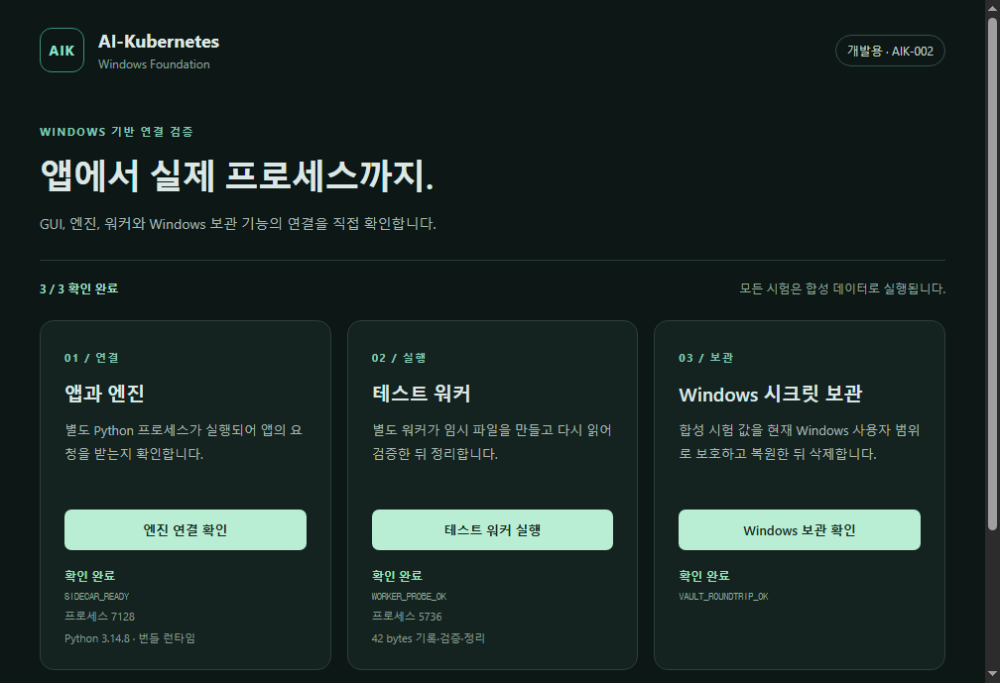

# 기존 태스크 구현·실행 기록 — 2026-10-12

**설치 가능한 Windows 기반 앱과 설치형 upstream 검사기를 구현했다.** 첫 Windows CI에서 설치된 GUI의 실제 버튼으로 Python sidecar·별도 worker·Windows 사용자 DPAPI를 실행하고 제거까지 통과했다. AIK-001은 완료했으며, AIK-002의 후보별 실측 비교를 계속 진행한다. AIK-003의 깨끗한 후보 Windows 설치 검증은 현재 환경에서 미실행이다.

이 기록은 [개발 태스크 정본](../planning/backlog.sqlite3)의 기존 순서와 완료 기준에 따른 구현 결과다. 요구사항 29개·태스크 90개·완료 기준 311개·의존성 365개를 변경하지 않았다. 기계가 읽는 결과는 [implementation-validation.json](../planning/implementation-validation.json)에 있다.

## 1. 구현한 코드

| 구성 | 구현 내용 | 경로 |
|---|---|---|
| Windows GUI | 한국어 React 화면, 엔진 연결·고정 worker·Windows 보관 확인 버튼과 실제 결과 표시 | `spikes/windows-foundation/src/` |
| 앱과 엔진 경계 | 제한된 preload, 발신 창·frame·URL·판본·workspace·request ID 검증, capability를 사용하는 private pipe | `spikes/windows-foundation/electron/` |
| Python sidecar·worker | 고정 JSON-lines 프로토콜, 별도 worker 프로세스에서 실제 임시 파일 생성·읽기·해시 대조·삭제 | `spikes/windows-foundation/python/aik_spike/server.py` |
| Windows 보관 시험 | 합성 데이터를 사용자 DPAPI로 보호하고 암호문 파일에 기록·읽기·복호화·정리 | `spikes/windows-foundation/python/aik_spike/vault.py` |
| Windows 설치·검증 | Python runtime을 묶은 NSIS 사용자별 개발 설치본, 실제 설치 GUI 실행·보고서·화면·제거 검사 | `packaging/`, `scripts/windows/`, `.github/workflows/windows-foundation.yml` |
| upstream 계약 검사 | 고정 AGS/VM 설치 bytes·wheel identity·공개 명령·schema/façade·실제 호환 결과 대조 | `tools/inspect_upstream.py`, `contracts/upstream/` |

GUI renderer는 세 가지 제한된 메서드만 받는다. 임의 명령·경로·비밀 값을 요청하거나 응답에 넣는 프로토콜은 거부한다. sidecar 시작 오류·시간 제한·예상하지 못한 종료는 사용자 비밀이나 입력을 그대로 노출하지 않는 오류로 바꾼다. Windows 동일 사용자 프로세스끼리의 OS 격리까지 구현한 것으로 해석하지 않는다.

## 2. 실제 Windows 실행

- 구현 소스: [`56523355d9cf3a2437989d1dd26f2e5ced1666d2`](https://github.com/jaeseongs95/AI-Kubernetes/commit/56523355d9cf3a2437989d1dd26f2e5ced1666d2)
- 원격 실행: [Windows foundation / run 38219549819](https://github.com/jaeseongs95/AI-Kubernetes/actions/runs/38219549819), 첫 시도 성공
- 실제 환경: Windows Server 2022 Datacenter x64, build 20348, 2 logical CPU, 약 8 GiB RAM, 관리자 계정
- 원본 근거: [Windows 실행 자료](../evidence/windows-foundation/38219549819/README.ko.md)

| 검증 | 실제 결과 |
|---|---|
| Python 시험 | 23개 중 **22 PASS, 1 SKIP**. SKIP은 비 Windows 전용 거부 검사 |
| Windows native DPAPI | 위 Python 시험에 포함된 실제 왕복·암호문 손상 검사 **2개 PASS** |
| Node IPC·프로세스 시험 | **8/8 PASS** |
| React/TypeScript 빌드 | PASS |
| frozen CPython·installer 생성 | PASS |
| 저장소 밖 한글·공백 경로 설치 | PASS |
| 설치된 실제 GUI → IPC → sidecar | PASS |
| 별도 worker의 파일 효과 | 42 bytes 생성·재읽기·해시 대조·삭제 PASS |
| GUI → 사용자 DPAPI 왕복 | PASS |
| 설치된 uninstaller로 제거 | PASS |

앱 보고서의 `packaged: true`, `frozen: true`, `window_visible: true`와 세 검사 결과를 확인했다. 실제 worker PID `5736`의 부모가 sidecar PID `7128`과 일치했다. 설치된 engine·Python DLL은 build 보고서의 해시와 일치하며, 원본 report·screenshot·다운로드한 설치 EXE도 독립 재계산한 hash와 일치했다.

개발 설치본은 118,718,430 bytes, SHA-256 `955d27bd62158b029e659ea04a65807599b8ac40f1ccd40190acdb6beea83a16`이며 서명 상태는 `NotSigned`다. 실제 모델·사용자 계정·AGS/VM 작업을 실행하는 완제품 설치본은 아직 아니다.

## 3. 실제 upstream 대조와 결함 수정

고정 AGS archive 1,473개 Git blob과 VM Python 소스 86개를 대조했다. non-editable VM wheel을 실제 설치해 공개 명령을 실행했고, 재현에 필요한 원본 wheel과 LICENSE·NOTICE를 [설치 입력 근거](../evidence/upstream/2026-10-12/README.ko.md)에 보존했다.

| 실제 명령·관측 | 결과 |
|---|---|
| AGS MCP initialize / tools/list | PASS, 28개 도구 |
| VM 공개 console 도움말·project init·status | exit 0 |
| 새 임시 VM 원장 | SQLite revision 4, application ID 1179469105, integrity `ok` |
| 생성한 VM Task/Attempt/provider call | 각각 0건 |
| AGS `fm/hello` | `-32601 Method not found` |
| VM `governance check-plugin` | exit 2, `GOVERNANCE_CONTRACT_MISMATCH`; 필요한 `host-integration.json` 부재 |

VM의 실제 `EngineApplication(runtime=…)`, `CodexRuntimePort`, 효과 직전 `OperationTraceScope`를 확인했다. AIK가 새 Task·재시도 권위를 만들지 않고 기존 공개 접점에 route/connection/account/pool/lease를 결속하는 계약을 고정했다. AGS↔VM의 현재 호환 실패는 후속 통합 차단으로 유지한다.

독립 코드·입력 검토에서 잘못된 backend 필드 타입, 과도한 JSON 정수, 비 ASCII capability, child 시작·종료 오류, GUI 상태 대조의 결함을 수정했다. 계약 JSON Schema에서는 digest 뒤의 마지막 개행을 허용하는 결함을 발견했다. 세 digest의 정확한 길이를 제한한 후 정식 Draft 2020-12 validator의 **독립 fixture 59개(positive 2, negative 57)**가 모두 통과했다. 기존 장부 65개와 새 upstream 검사기 7개를 합한 **72개 회귀 시험도 통과**했다.

## 4. 완료 판정과 남은 실행 조건

| 태스크 | 현재 판정 | 남은 조건 |
|---|---|---|
| AIK-001 | **done** | 설치형 공개 인터페이스 기준선·소유권·지원 matrix·결속 계약과 독립 대조 완료. 실제 governed runtime은 후행 범위 |
| AIK-002 | **in_progress** | 세 완료 기준과 Electron 실제 실행은 충족. 기존 `verification`의 후보별 설치·IPC·worker·메모리 실측을 위해 Tauri 비교 보완 중 |
| AIK-003 | **blocked** | 정책·runtime bundle·Server 설치는 통과. 개발 도구가 없는 깨끗한 후보 Windows 설치는 미실행 |

AIK-003의 기존 원문은 “깨끗한 후보 Windows 환경”과 “개발 도구가 없는 환경”을 요구한다. 현재 CI에서 PATH를 제한한 결과를 머신의 개발 도구 부재로 바꾸지 않는다. 선택한 Windows 11 표준 사용자 환경에서 동일 개발 설치본의 작은 설치·GUI·worker·DPAPI·제거 검증이 필요하다. 003을 완료하려고 제품 전체 E2E나 모든 지원 버전의 최종 qualification까지 요구하는 것은 아니다.

현재 083은 001·002·003에 의존하며, 뒤의 주요 구현 태스크도 083을 따른다. 기존 의존성과 완료 기준은 그대로 유지한다. Tauri 후보 비교는 002의 현재 작업으로 이어가며, 깨끗한 후보 Windows 검증은 실제 실행 증거가 확보되기 전까지 차단 상태를 유지한다.

## 5. 사용자 요청 기능의 제품 상태

| 요청 | 현재 구현·검증한 부분 | 제품 기능으로 남은 부분 |
|---|---|---|
| 멀티벤더 시크릿 공간 | Windows 사용자 암호화·파일 저장·복원 경계 시험 | 실제 자격 증명 CRUD·해제·rotation·벤더별 연결·GUI 관리 |
| Dot 역할의 총괄 모델 지정 | VM 공개 역할·runtime seam·모델/인증/도구 지원 계약 | 모델 발견·프로필 설정·총괄 연결·실제 모델 실행·재시작 routing |
| Windows GUI 출시 | 설치되는 GUI와 실제 엔진·worker·보관 호출 | 프로젝트·목표·실행·결과·복구 화면, 제품 E2E와 서명된 출시본 |

각 기능은 기존 태스크에 남아 있으며, 기반 spike 성공으로 제품 기능을 완료 처리하지 않았다. 실제 계정·모델·도구 qualification, 의존 개발 목표, GUI 제품 검증과 최종 배포는 각각 082·086·044·059·064의 근거가 필요하다.
