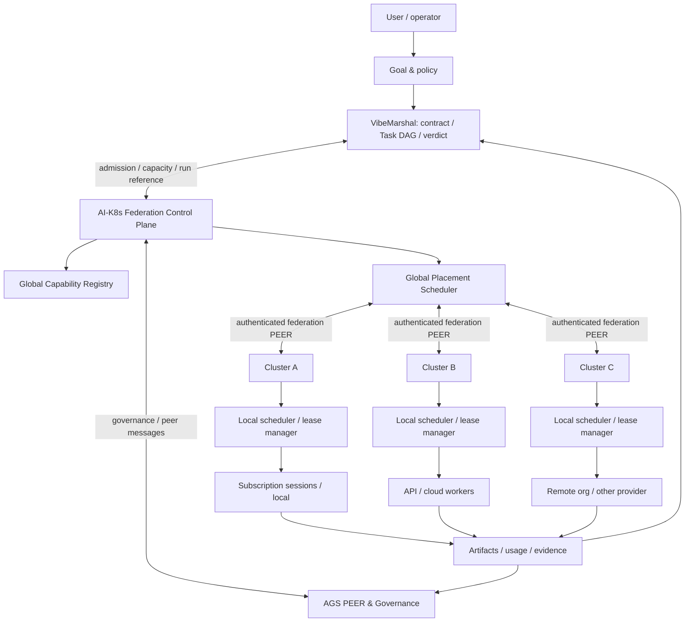

# AI-Kubernetes — 최초 설계문서

- **문서 상태:** Initial Architecture Proposal v0.1
- **작성 기준일:** 2026-10-12
- **제품 목적:** 벤더 독립형 AI 실행 자원 제어, 탄력적 병렬 실행, 다중 클러스터 PEER 연합
- **구현 상태:** 설계 단계. 문서의 계약·상태·API 예시는 제안이며, 현재 동작하는 구현을 의미하지 않는다.
- **기반 프로젝트:** [Agent Governance Suite](https://github.com/jaeseongs95/agent-governance-suite), [VibeMarshal](https://github.com/jaeseongs95/vibemarshal)

> **2026-10-12 후속 개발 계획:** 이 문서는 최초 아키텍처 v0.1 기록이다. 이후 사용자가 **멀티벤더 인증 관리 공간, 총괄 에이전트 모델 지정, Windows GUI 첫 출시**를 확정했다. 최신 작업 범위와 완료 기준은 [개발 계획 v0.3](development-plan.ko.md), [SQLite 장부](../planning/backlog.sqlite3), [전체 태스크](development-backlog.ko.md)를 기준으로 한다. 아래 §13의 최초 마일스톤·두 클러스터 E2E는 원안이며, 현재 장부는 단일 Windows 클러스터 E2E와 후속 연합 E2E를 구분하는 순서를 `DEC06: proposed`로 제시한다. VM/AGS의 책임 경계와 연합 비전은 유지한다.

## 1. 문제 정의와 비전

AI 에이전트 사용자가 이미 확보한 컴퓨팅 자원은 벤더·인증·실행 호스트마다 분리돼 있다. 구독형 CLI/Cloud 세션, 사용량 기반 API, 로컬 LLM, 원격 컴퓨터의 에이전트는 서로 다른 생명주기와 권한을 갖는다. 이들을 수동으로 연결하면 작업 수가 늘수록 다음 문제가 발생한다.

- 독립 작업마다 사람이 세션을 생성·배분·재확인해야 한다.
- 실행 위치·벤더 변경 때 상태와 근거가 끊긴다.
- 완료 선언, 메시지 수신, 승인, 독립 검토와 실제 성공이 혼동된다.
- 남은 쿼터·크레딧·캐시 상태·비용 때문에 최적 자원 배치가 복잡해진다.
- 단일 컴퓨터에 한정된 PEER만으로는 클라우드·노트북·다른 조직을 통합할 수 없다.

**비전:** 사용자가 목표와 정책을 제시하면 시스템이 서로 다른 AI 실행 자원을 하나의 논리 클러스터로 등록하고, 필요할 때만 작업에 임대하고, 실행·검증 결과를 모아 반환한다. 그 클러스터 여러 개도 인증된 PEER로 연합한다.

구현의 핵심은 단일 초고속 모델이 아니라 **지능 자원의 탄력적 임대(lease)와 신뢰 가능한 실행 수명주기**다. AWS에서 짧은 시간 VM 여러 대를 임대해 병렬 작업을 수행하고 해제하는 방식에서 영감을 받지만, 여기서 관리하는 단위는 CPU 코어가 아니라 **모델·세션·도구·권한을 가진 AI 워커**다.

## 2. 설계 원칙과 불변조건

### 2.1 설계 원칙

1. **Vendor-neutral:** OpenAI, Anthropic, Google, 로컬 모델 등을 표준 `Capability`와 `ResourcePool`로 추상화한다.
2. **Auth-neutral ≠ auth-equivalent:** 구독·API 키·호스트 세션을 자원으로 장착할 수 있으나 각기 다른 권한/과금/사용 조건은 유지한다.
3. **Execution is leased:** 워커를 영구 점유하지 않고 기간·예산·범위를 제한한 lease로 할당한다.
4. **Federation-first boundary:** 클러스터 내부와 클러스터 간 통신은 동일한 상위 계약을 사용하되 서로 다른 신뢰 도메인으로 처리한다.
5. **Governance before dispatch:** 인가, 작업 계약, 실행 전 입력 확인, 감사를 배치보다 우선한다.
6. **Measured optimization:** 속도, 토큰, 비용, 캐시 적중률을 추정이 아닌 관측으로 평가한다.
7. **Evidence-driven completion:** ACK나 provider success가 아니라 완료 기준과 실증 근거로 최종 상태를 결정한다.
8. **Explicit uncertainty:** 외부 호출의 완료 여부가 불명확하면 임의 재발사하지 않는다.

### 2.2 필수 불변조건

- 같은 논리 작업의 외부 부작용을 불명확한 상태에서 자동으로 이중 실행하지 않는다.
- 클러스터 간 자격증명 원문을 전달하지 않는다. 각 클러스터는 자신의 벤더 자격증명만 소유한다.
- Global Scheduler의 배정은 Local Scheduler/VM의 실행 권한을 자동으로 부여하지 않는다.
- 수신 확인(ACK), 실행 요청 접수, 실행 성공, 검증 통과, 최종 완료는 서로 다른 상태다.
- 증거, 실패, 취소, 재시도 근거를 기록 없이 성공으로 덮지 않는다.
- 입력·권한·예산이 변경되면 새로운 실행 승인 필요 여부를 재판정한다.
- 공급자 약관, 공식 인증 경로, quota/rate limit을 우회하지 않는다.

## 3. 범위와 책임 소유권

| 계층 | 담당 | 권위 데이터 / 경계 |
| --- | --- | --- |
| **AI-Kubernetes Global Control Plane** | 클러스터 등록/연합, 전역 자원 탐색, 할당 예산, 클러스터 선택, federation 정책 | `cluster_id`, 전역 allocation, lease routing, federation audit |
| **AI-Kubernetes Local Resource Plane** | provider adapter, 용량 광고, capacity reservation, worker lease/종료, 현지 policy enforcement | `pool_id`, `worker_id`, `lease_id`, 런타임 가용성 |
| **VibeMarshal** | Goal Contract, Plan/Task DAG, 승인 대상, 실행·관측·복구·검증/GoalVerdict | Goal/Plan/Task/Attempt 및 실행 판단의 권위 원장 |
| **Agent Governance Suite** | 세션 협업/PEER, 메시지 ACK/handoff, 거버넌스 워크플로, 실행 근거/독립 감사와 continuity | PEER 메시지, 협업 상태, 검증·감사 추적 |
| **JEV 내부 계층** | 입력/스킬 메타정보의 분류·정리·평가를 통해 AGENT를 보조 | 최종 스킬 결정권 없음; RAW 입력 변경 금지 |
| **Provider adapter** | 벤더별 API/CLI/Cloud 실행 계약, 기능·한도·usage 관측, 취소/결과 회수 | 실제 provider job 및 provider별 인증 격리 |
| **Artifact/Evidence store** | 산출물, 체크섬, 평가 결과 보존 | 저장소별 접근통제와 증거 identity |

**중복 원장 금지:** VM의 Goal/Task/Attempt 상태를 AI-Kubernetes가 새로운 권위 원장으로 복제하지 않는다. AI-Kubernetes는 `lease`·`placement` 상태에 책임지고, 상호 참조 ID와 이벤트를 통해 VM/AGS에 결합한다. 어느 계층이 어떤 판정을 내리는지 계약으로 확정한다.

현재 upstream AGS는 기본적으로 동일 OS 사용자 환경의 로컬 협업을 문서화하고 있으며 외부 PEER 연합은 이 설계에서 구현할 확장이다. VM은 별도 검증/승인 경계와 제한 사항을 가진 프리릴리스이므로 모든 다중 벤더 경로가 이미 통과했다고 가정하지 않는다.

## 4. 핵심 아키텍처



### 4.1 하나의 클러스터

각 클러스터는 다음 인터페이스를 갖는다.

- `Capability Registry`: 어떤 모델/호스트/도구와 어느 추론 수준이 **실제로 사용 가능한지** 광고.
- `Admission Controller`: 요청된 효과 범위, 데이터 반출 조건, 의존성, 예산, 쿼터, 라이선스 적합성을 검사.
- `Local Scheduler`: ready Task를 사용할 수 있는 pool과 worker에 배치.
- `Worker Lease Manager`: 예약, 생성/재연결, 실행, 관측, 만료, 정리.
- `Provider Adapters`: 벤더 특수성을 boundary 내부에 캡슐화.
- `PEER Gateway`: 클러스터 외부와 계약 메시지·이벤트 교환.
- `Evidence Relay`: 결과와 증거를 체크섬/접근권한과 함께 회수.

### 4.2 클러스터 연합

Global Scheduler는 하위 클러스터 내부의 개별 계정이나 토큰을 알 필요가 없다. 클러스터가 서명/인증된 범위에서 **지원 capability, 사용 가능한 용량, 가격/쿼터 힌트, 데이터 영역, 정책 조건**을 광고하면 충분하다.

전역 스케줄링은 *어느 클러스터가 맡을지*를, 로컬 스케줄링은 *그곳의 어떤 자원으로 처리할지*를 결정한다. 작업 계약은 부모/자식 범위를 명시하고, 하위 클러스터는 허용되지 않는 요청을 거절할 수 있어야 한다.

상위 클러스터의 완료 선언은 하위 클러스터의 감사 근거를 조회할 수 있을 때만 신뢰하며, 공급자별 API 토큰, 원시 private workspace 경로나 비밀 설정은 교환하지 않는다.

### 4.3 Kubernetes와의 관계

Kubernetes의 control plane, scheduler, lease, worker pool, federation, scale-to-zero는 **아키텍처 비유**다. 최초 버전은 Kubernetes CRD, Pod, kubelet 또는 etcd 호환을 요구하지 않는다. 향후 실제 Kubernetes 배포는 별도 선택지다.

## 5. 자원 등록과 인증 경계

### 5.1 ResourcePool 모델

자원은 **벤더가 아니라 실행 경로**를 기준으로 식별한다. 동일한 Opus 모델이라도 Claude Code 구독 경로, Anthropic API 경로, 다른 지원 플랫폼의 API 경로는 서로 다른 pool이다.

```yaml
# 초기 제안용 스키마. 구현된 설정 형식이 아님.
pool_id: anthropic-api-prod
provider: anthropic
transport: api
credential_ref: secret://local/anthropic-prod
capabilities:
  - model: claude-opus-example
    efforts: [high]
    operations: [reason, tool_use]
limits:
  max_parallel: 8        # 관측·계약으로 확정할 값. 예시 숫자.
  remaining_budget_usd: null
policy:
  data_classification: [public, internal]
  external_transfer: explicitly_allowed
```

`credential_ref`는 비밀 식별자이지 비밀 값이 아니다. `models`, `efforts`, `max_parallel`, `price`는 설치 시점의 실제 벤더 capability와 계정 정책을 기준으로 조회하거나 명시적 등록을 검증한다. *예시 설정에 있는 모델/한도는 지원 확정을 의미하지 않는다.*

### 5.2 인증 유형

- **API:** 공식 API 키·워크스페이스/조직을 해당 adapter가 보관·사용한다. 비용과 사용량은 별도 측정한다.
- **구독 호스트:** 공급자가 자동화/세션 실행을 공식 지원하고 허가한 경우에만 호스트를 사용한다. 구독 자격증명을 제3자 API 키처럼 추출·변환하지 않는다.
- **로컬:** 프로세스/모델 서버 연결에 로컬 OS 권한·GPU·메모리 자원 정책을 적용한다.
- **원격 연합:** 클러스터 간 상호 인증하며, provider credential이 아닌 제한된 작업 위임 권한을 교환한다.

**장착 = 무조건 실행 가능**이 아니다. 인증과 사용자 연결은 성공했어도 API 호출, Cloud worker 생성, 도구 실행 권한이 다를 수 있다. 지원되지 않는 route는 `UNSUPPORTED`로 표시하고 안전하게 거절한다.

## 6. 작업 계약·분해·스케줄링

### 6.1 작업 입력

VM이 제공하는 Goal/Plan/Task를 AI-Kubernetes에 연결할 때 아래를 보존한다.

- 목표/작업 ID, 입력 판본·digest, 완료 기준과 검증 oracle 경계
- 명시된 효과 범위, 승인 조건, 데이터 등급, 허용된 제공자·지역
- DAG 선행 작업과 동시 실행 가능 여부
- 필요한 모델/스킬/도구/추론 수준과 최소 품질 조건
- 허용 최대 금액/토큰/시간, quota reserve, 중단 조건
- 부작용 유형(idempotent, read-only, external mutation 등)과 재시도 허용 정책

### 6.2 후보 선택

```text
ReadyTasks = DAG 의존성이 충족된 Task
EligiblePools = capability ∩ auth ∩ policy ∩ data boundary ∩ quota ∩ budget
Capacity = pool별 검증된 동시성 / 토큰·분당 요청 한도 / 예약된 실행량
DesiredWorkers = bounded_schedule(ReadyTasks, EligiblePools, Capacity, Budget)
```

**중요:** `독립 작업 39개`를 확인했다고 자동으로 worker 39개를 보장하거나 발사하지 않는다. 무제한 fan-out은 오히려 cold-cache, 초기 프롬프트 중복, rate-limit, 부작용 충돌, 비용 폭증을 초래할 수 있다. 시스템은 이익을 실제 측정하고 `max_parallel`, `budget`, provider 제한을 넘지 않는 선에서 동시성을 선택한다.

일정·품질·비용을 동시에 최적화하되 정책은 단일 목적함수로 고정하지 않는다. 예를 들어 사용자는 `min_makespan_under_budget`, `min_cost_before_deadline`, `maximize_qualified_work_before_credit_expiry` 같은 목표를 선택할 수 있다. 크레딧 만료가 비용 소진 자체를 정당화하지는 않으며 **실질적인 승인된 작업**에만 사용한다.

### 6.3 캐시 최적화

- 공통 정책/도구/증거 prefix와 Task별 입력 suffix를 구분한다.
- provider/model/TTL/workspace/계정 간 캐시 공유를 **가정하지 않는다**.
- 캐시 hit는 서버 usage에서 검증하고, 개별 worker 결과의 성공과 따로 판정한다.
- 초기 요청이 서버에서 캐시를 준비하기 전에 후속 요청을 대량 전송하지 않도록 provider별 전략을 둔다.
- 같은 데이터가 반복된다는 이유로 비밀 입력 또는 hidden oracle을 여러 Task에 공유하지 않는다.

## 7. Worker/Task 생명주기

### 7.1 Worker Lease

```text
DISCOVERED → ELIGIBLE → RESERVED → ACTIVE → DRAINING → RELEASED
                        ↘ FAILED / UNKNOWN / EXPIRED
```

- `RESERVED`: 자원 상한·예산·기간·작업 범위를 예약했지만, 아직 실제 실행을 증명하지는 않음.
- `ACTIVE`: adapter의 실행 job/session identity로 실제 시작을 관측.
- `DRAINING`: 신규 작업 유입을 막고 현재 작업·사용량·산출물 회수를 기다림.
- `RELEASED`: 세션 정리, lease/예약 해제, 상태 영속 기록 완료.
- `UNKNOWN`: 네트워크 장애 등으로 실행 여부가 불명확. 동일한 외부 부작용을 자동 재발사하지 않음.

구독/Cloud가 API로 세션 생성·종료를 지원하지 않는 경우 `lease`는 실제 VM 인스턴스 임대가 아니라 **기존 호스트 세션에 대한 작업 사용권**일 수 있다. provider별 지원 수준을 별도 표기한다.

### 7.2 Task 결과

```text
CREATED → WAITING_DEPS → READY → ASSIGNED → RUNNING → RESULT_RECEIVED
                                          ↘ BLOCKED / UNKNOWN / FAILED
RESULT_RECEIVED → VALIDATING → COMPLETE | REWORK_REQUIRED | FAILED
```

여기서 실행 상태는 VM의 권위 Task/Attempt 상태를 참조하고, AI-Kubernetes의 배정과 lease 상태는 별도로 관리한다. 최종 성공은 VM GoalVerdict/AGS 요구 검증에 따른다.

### 7.3 PEER 메시지와 멱등성

통신은 최소한 다음의 식별자를 가진다.

```json
{
  "protocol": "aik-federation-v0.1-proposal",
  "message_id": "unique-message-id",
  "goal_id": "goal-id",
  "task_id": "task-id",
  "attempt_id": "attempt-id",
  "lease_id": "lease-id",
  "source_cluster": "cluster-a",
  "target_cluster": "cluster-b",
  "kind": "task.offer",
  "contract_digest": "sha256:...",
  "deadline": "ISO-8601",
  "approval_ref": null,
  "artifact_refs": []
}
```

이는 **개념 설계**이며 현재 AGS의 실제 PEER wire format과 같다고 주장하지 않는다. 형식은 AGS 메시지 수명·VM 원장 계약을 확인한 후 버전링한다.

메시지 전달 결과와 처리 ACK를 구분하고, `message_id`/`task_id`/`attempt_id`/`lease_id` 조합으로 중복 전달을 감지한다. ACK 손실은 재발사 허가가 아니다. 작업 재시도 여부는 provider의 실제 job identity, 부작용 유형, VM/AGS 기록을 먼저 대조해 결정한다.

## 8. Federation 프로토콜 설계

### 8.1 최소 메시지 유형

| 메시지 | 목적 | 비고 |
| --- | --- | --- |
| `cluster.hello` / `cluster.capabilities` | 신뢰 관계 수립과 가용 capability 광고 | 민감한 재고/토큰 값 노출 최소화 |
| `task.offer` / `task.accept` / `task.reject` | 범위가 고정된 Task 위임과 거절 | 수락은 작업 완료가 아님 |
| `lease.grant` / `lease.renew` / `lease.release` | 사용권과 만료 관리 | fencing token 검토 |
| `task.progress` / `task.result` | 관측과 결과 전달 | artifact digest로 연결 |
| `task.cancel.request` / `task.cancel.result` | 안전한 중단 요청·결과 | 즉시 종료 보장 금지 |
| `audit.request` / `audit.verdict` | 별도 독립 검증 요청·판정 | 실행 승인과 독립 |

### 8.2 실패 처리

- **네트워크 단절:** task 상태 `UNKNOWN`, lease 기간·heartbeat·peer 상태를 구분. 외부 변경은 재발사하지 않고 기존 실행 관측을 우선.
- **서버 throttling:** rate-limit 헤더·provider 정책에 맞춘 제한된 backoff, 다른 자원으로 전환할 때 품질·도구·인가 재검사.
- **크레딧 소진:** 해당 pool에서 신규 예약 중단, 진행 중 작업은 공식 취소·중지 지원 수준에 맞춰 처리.
- **중복 callback:** 이미 수용한 결과의 digest와 identity 대조, 다른 내용이면 충돌/감사 대상으로 격리.
- **잘린 결과:** HTTP 성공이더라도 출력·증거·완료 조건 미달이면 완료 판정 불가.
- **취소 경쟁:** 취소 중 성공한 결과가 있을 수 있으므로 종료/환불/정산을 확정하지 않고 실제 provider 사용량 회수.
- **클러스터 침해:** 해당 peer 권한 회수·격리, 전송/실행 evidence 보전, 비밀 교환 범위 없음 확인.

## 9. 보안·정책·승인

인증된 사용자의 등록·연결 권한과 실제 실행/배포/삭제/외부전송 승인권을 구분한다. 위험 작업의 승인 경계는 VM과 AGS 계약에 따르며 AI-Kubernetes가 임의로 승격하지 않는다. 리액션 같은 간편 UI를 승인 수단으로 제공하더라도 호스트가 권한자, 대상·범위, 단일 실행 의도를 확실히 전달하고 검증할 수 있을 때만 사용한다.

필수 통제:

- 클러스터 간 mutual authentication, 최소 권한, 짧은 유효기간의 task-scoped token.
- secret manager/keyring을 통한 자격정보 참조; 프롬프트·PEER 메시지·evidence에 원문 키 기록 금지.
- 테넌트·워크스페이스·프로젝트별 격리, 별도 데이터 분류·지역/외부전송 정책.
- 요청 단위 정책 digest, 실행 관측(실제 모델/effort/host), 증거 해시, 감사 역할 분리.
- 예산/쿼터 상한의 fail-closed admission. 금액 한도는 provider 청구 시점과 지연 때문에 절대적인 결제 상한 보장은 아님.
- 외부 실행 capability가 없는 provider를 스크립트/브라우저 우회 방식으로 강제로 확장하지 않음.

## 10. JEV 계층과 에이전트 판단

JEV는 AI-Kubernetes가 임의로 선택하는 외부 도구가 아니라 **AGS/VM 내부에 편입되는 보조 추상계층**으로 취급한다.

1. 사용자 RAW 프롬프트를 **그대로 보존**한다. JEV를 위해 앞단의 별도 LLM이 원문을 재작성하지 않는다.
2. 코드는 이미 확인된 작업 모드, 대상, 스킬 메타데이터, 제약을 공통 JSON REQ로 구조화한다.
3. JEV ON이면 JEV가 이를 분류·정리·평가하고, OFF 또는 호출 불가 시 해당 벤더의 품질 기준을 충족하는 최저비용 분류 LLM을 fallback 후보로 사용한다(운영 계약이 허용하는 범위).
4. **최종 스킬 선택은 실제 AGENT(Codex/Claude 등)**가 수행한다. JEV의 추천·분류 결과를 강제로 선택으로 승격하지 않는다.
5. AI-Kubernetes의 모델·worker *배치 결정*과, 에이전트 내부의 *스킬 선택*을 서로 다른 결정으로 분리한다.

## 11. API 계약(제안)

초기 인터페이스는 아래 책임을 나눈다. 실제 HTTP/gRPC/MCP 메시지 형식은 구현 단계에서 확정한다.

| 인터페이스 | 의미 |
| --- | --- |
| `registerPool(resourceDescriptor)` | 지원 가능한 provider·host 자원 등록 |
| `advertiseCapabilities(clusterId)` | 실행 가능한 기능·제약과 갱신 시각 광고 |
| `requestPlacement(taskContract)` | Task를 어느 클러스터·pool에 맡길지 검토 |
| `reserveLease(taskId, poolId, constraints)` | capacity/budget reserve. 실행은 별도 단계 |
| `dispatchAttempt(leaseId, attemptRef)` | VM/AGS 승인·근거를 포함해 실제 실행 전달 |
| `observeAttempt(providerJobRef)` | 연결된 작업의 실제 상태 확인 |
| `receiveEvidence(artifactRef, digest)` | 결과·사용량·증거 회수 |
| `releaseLease(leaseId)` | 작업 종료 후 사용권·자원 반환 |

모든 변경 요청은 `request_id`, `contract_digest`, `expected_revision` 같은 중복·경합 방지 조건을 요구하도록 설계한다.

## 12. 관측과 비용 최적화

최소 대시보드 지표:

- Goal/Task 총 개수와 ready/running/unknown/blocked/verified 구분
- 워커 수: registered / reserved / active / draining / released
- 시간: queue delay, startup latency, inference duration, end-to-end makespan, gather/audit 지연
- 용량: provider별 active concurrency, throttling, quota 잔여 추정, lease 만료
- 토큰: 일반 입력/캐시 읽기/쓰기/출력과 provider별 usage 근거
- 비용: 추정·확정·잔여 예산을 분리; 구독 quota와 API 청구를 합산하지 않음
- 품질: Task 단위 결과 완결성, 재시도율, 독립감사 판정, 변경 후 회귀 실패

**속도와 경제성은 별도 검증:** 39개 worker의 makespan이 단일 worker보다 짧아도 총 토큰·비용이 더 적다고 자동 결론 내리지 않는다. 순차 실행, 제한 병렬, 대규모 병렬을 같은 과제·성공 기준·모델 조건에서 비교한다.

## 13. MVP 마일스톤

| 단계 | 범위 | 핵심 수용 기준 |
| --- | --- | --- |
| **M0: 설계 고정** | 책임 경계, protocol v0, 상태·권한·실패 모델 확정 | AGS/VM 실제 인터페이스와 제안 계약 차이 식별, 문서 승인 |
| **M1: 단일 클러스터** | 공식 경로의 provider adapter 2종, pool registry, worker lease, VM Task 연결 | 서로 다른 두 provider에 독립 read-only Task 배치·결과·증거 회수 |
| **M2: PEER 연합** | 클러스터 2개 상호 인증, capability 광고, task offer/accept/result | 동일 Goal 일부를 원격 클러스터에 위임, ACK/완료/감사 분리 |
| **M3: 탄력 운영** | admission, quota/budget guard, backpressure, scale-to-zero | worker 생성/사용권 해제와 quota 장애·재시도 안전성 검증 |
| **M4: 운영 검증** | 장애 주입, 독립 감사, 사용량 정산, 운영 가이드 | 원격 단절·중복 callback·모델 fallback 제약까지 재현 시험 |

### 13.1 첫 E2E 시나리오

1. 독립적이고 **읽기 전용인** 2개 Task를 가진 Goal을 VM에서 준비·인가한다.
2. A 클러스터는 Codex 호스트, B 클러스터는 별도 지원 provider/API 워커를 광고한다.
3. AI-Kubernetes가 capacity와 정책을 검사하고 양측에 lease를 배정한다.
4. AGS PEER가 위임 메시지, 수신 ACK, 결과 회신을 별도로 기록한다.
5. 각 worker가 evidence digest와 실제 usage를 반환한다.
6. VM GoalVerdict와 AGS 독립 검증 조건을 만족한 뒤 최종 보고한다.
7. 양쪽 lease를 해제하고 해당 영속 상태와 증거를 재조회한다.

### 13.2 필수 부정 테스트

- 미등록/만료된 인증, capability 불일치, 최소 권한 부족
- quota exhausted, budget exhausted, API 429, server timeout
- 의존성 미충족 상태의 부당한 fan-out 거부
- PEER 메시지 중복·지연·역전, callback 중복, network partition
- provider success이지만 잘린 출력·불완전 evidence
- 취소 직전 결과 도착, 미확정 실행 뒤 재실행 요청
- 허용되지 않은 외부 데이터 전송과 인증 경계 침범 차단
- 서로 다른 workspace/모델/TTL 때문에 캐시 미적중인 경우 정산 분리

## 14. 열린 결정 사항

이 문서에서 미리 확정하지 않은 항목:

1. 외부 PEER의 전송 규약(현재 AGS 메시지 수명과의 호환 범위, 서명/암호화 방식)
2. Worker pool 광고의 노출 정책과 공용 capability 스키마의 versioning
3. VM 원장과 federation lease 원장의 상호 참조/트랜잭션 경계
4. 여러 클러스터가 동일 목표를 다룰 때 권위 coordinator 선출/복구
5. 지원되는 구독형 호스트 adapter별 공식 세션 생성·종료·usage 조회 가능 범위
6. 사용량 및 요금 집계의 지연·환불·프로모션 크레딧 처리 방식
7. 1차 구현 언어/서버 패키징, 배포 방식, 실제 Kubernetes 연동 여부
8. AI-Kubernetes 자체 라이선스 및 외부 기여 정책

## 15. 비목표와 성공 정의

**비목표:** 특정 벤더 인증 우회, 요금/쿼터 우회, 무제한 병렬 실행 보장, 모델 학습 플랫폼 제작, 검증 없이 완료 처리, Kubernetes 원격 API 완전 호환.

**성공 정의:** 사용자가 장착한 둘 이상의 *허가된 실행 자원*을 프로젝트/벤더 경계 밖에서도 하나의 Goal 아래 안전하게 배치하고, 결과·증거·사용량을 실제로 회수하며, 원장과 승인 경계를 보존한 채 필요 없는 worker를 반환할 수 있는 것.

---

**결정 문장:** AI-Kubernetes는 AI 모델을 감싸는 또 하나의 챗봇이 아니다. **AGS의 협업·거버넌스, VM의 Goal/실행 권위 계약을 기반으로, 이질적인 AI 자원을 임대·배치·검증·반환하고 클러스터끼리 연합시키는 벤더 독립 컨트롤 플레인**을 지향한다.
